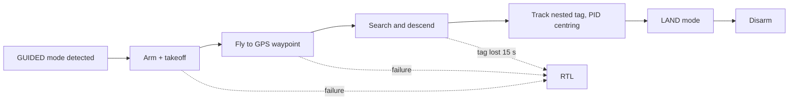

# Vision-Based Precision Landing for ArduPilot (ROS 2)

Autonomous takeoff, GPS waypoint flight and AprilTag-guided precision landing for ArduCopter, built on ROS 2 Humble and MAVROS. It runs on a Raspberry Pi 5 with an IMX500 camera and a Cube Orange+ flight controller.

> **Read [SAFETY.md](SAFETY.md) before you power the drone.** With this stack running, switching the flight controller to GUIDED mode **arms the vehicle and takes off automatically**.

Developed by Abhin M for ICFOSS. Released under the MIT license.

<!-- TODO: add a photo or GIF of the drone landing on the tag: docs/images/demo.gif -->

## What it does

1. You switch the Cube to **GUIDED** with the RC transmitter.
2. The mission executive arms, takes off to the configured altitude (default 6 m) and flies to a GPS waypoint.
3. At the waypoint, the landing server searches for a **nested AprilTag** (three tags of different sizes in one target), descends while centring on it with a PID loop, and switches to LAND mode near the ground.
4. If anything goes wrong (lost MAVROS heartbeat, rejected goal, tag lost for 15 s) it switches to **RTL**.



## Results

| Camera mode | Max AprilTag detection altitude | Tag |
| --- | --- | --- |
| IMX500, 640x480 | 7-8 m | 22.7 cm outer tag, family 48h12 |
| IMX500, 1280x720 | 10-12 m | 22.7 cm outer tag, family 48h12 |

Landing accuracy (distance from tag centre at touchdown): TODO: add measured values.

How these numbers relate to tag size and resolution: [docs/detection-range.md](docs/detection-range.md).

## System overview

```text
IMX500 camera --> camera node --> apriltag_ros --> /detections
                                                       |
RC (mode switch) --> Cube Orange+ <--USB--> MAVROS     v
                         ^                     landing_server  --> /mavros/setpoint_velocity/cmd_vel_unstamped
                         |                     navigation_server --> /mavros/setpoint_raw/global
                         |                     mission_executive (arm, takeoff, sequencing, failsafe)
                         +---- everything runs in Docker on a Raspberry Pi 5
```

## Hardware

| Part | Used in this project |
| --- | --- |
| Flight controller | Cube Orange+ running ArduCopter |
| Companion computer | Raspberry Pi 5 (Docker, ROS 2 Humble in an Ubuntu 22.04 container) |
| Camera | IMX500, mounted facing straight down |
| Camera mount | 3D-printed PLA holder, designed in Onshape ([files](docs/hardware/camera-holder/README.md)) |
| Link | USB cable from the Cube to a Pi 5 USB port (MAVROS) |

Details, wiring and the power warning: [docs/hardware/README.md](docs/hardware/README.md).

## Quick start

1. Read [SAFETY.md](SAFETY.md).
2. Build the hardware: [docs/hardware/README.md](docs/hardware/README.md) and the [camera holder](docs/hardware/camera-holder/README.md).
3. Set up the Raspberry Pi 5 with the Docker image (separate repository): TODO: add Docker repo link.
4. Print your tag: [docs/tags.md](docs/tags.md).
5. Edit [config/params.yaml](config/params.yaml): target GPS position, altitude, tag IDs.
6. Test in simulation first: [docs/simulation.md](docs/simulation.md).
7. Run on hardware with propellers off, then tethered, then free flight: [docs/software/README.md](docs/software/README.md).

## Documentation

| Document | Contents |
| --- | --- |
| [SAFETY.md](SAFETY.md) | Safety rules and checklists (reusable for any drone project) |
| [docs/hardware/README.md](docs/hardware/README.md) | Parts, wiring, power, Cube setup |
| [docs/hardware/camera-holder/README.md](docs/hardware/camera-holder/README.md) | IMX500 top-down camera holder: files, printing, mounting |
| [docs/software/README.md](docs/software/README.md) | Docker, running the stack, verifying topics |
| [docs/software/nodes.md](docs/software/nodes.md) | The three nodes, topics, actions |
| [docs/software/config.md](docs/software/config.md) | Every parameter in `config/params.yaml` |
| [docs/landing-algorithm.md](docs/landing-algorithm.md) | Landing phases, PID, touchdown logic |
| [docs/tags.md](docs/tags.md) | Nested tag design and how to change IDs |
| [docs/detection-range.md](docs/detection-range.md) | Maximum detection range equation |
| [docs/simulation.md](docs/simulation.md) | SITL / Gazebo testing |
| [docs/troubleshooting.md](docs/troubleshooting.md) | Common problems and fixes |
| [docs/known-issues.md](docs/known-issues.md) | Known code issues and limitations |

## Repository layout

```text
Precision_landing_ardupilot/
  README.md
  SAFETY.md
  LICENSE
  config/params.yaml            all tunable parameters
  launch/uav_core.launch.py     starts the three nodes with the parameter file
  src/
    autonomous_flight_stack/scripts/   mission_executive.py, navigation_server.py, landing_server.py
    uav_interfaces/action/             NavigateToWaypoint.action, PrecisionLand.action
  docs/
```

## License

MIT, see [LICENSE](LICENSE).
