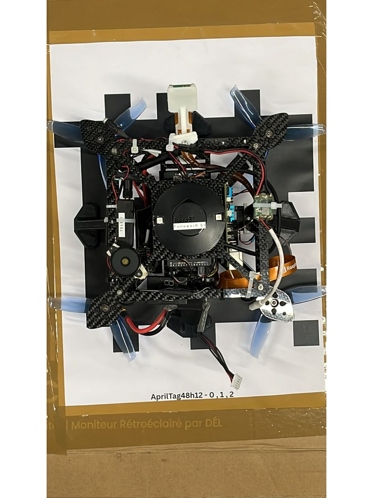
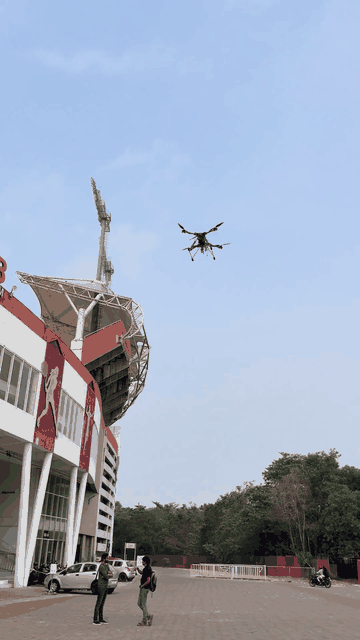
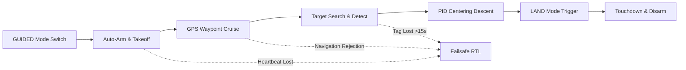
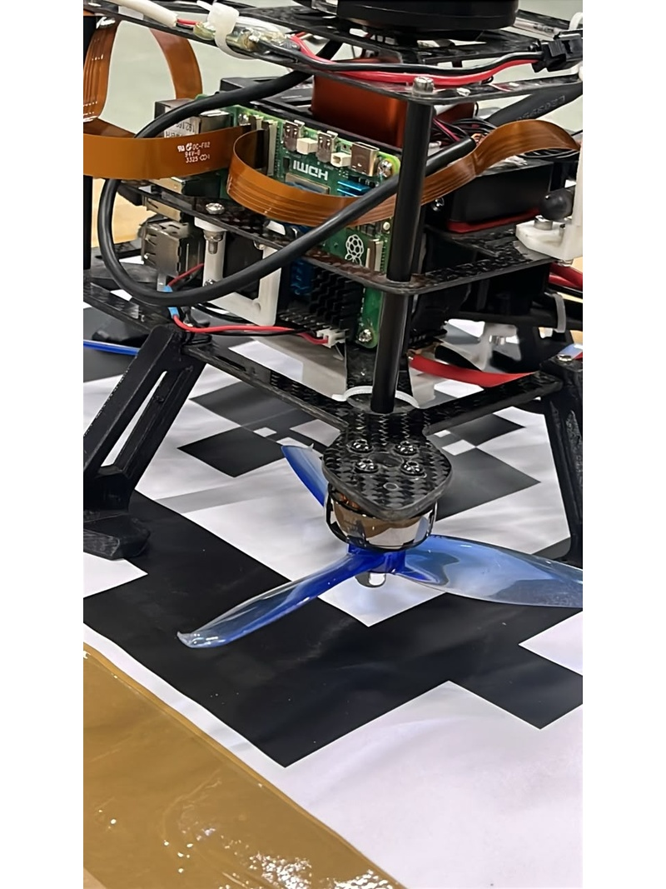
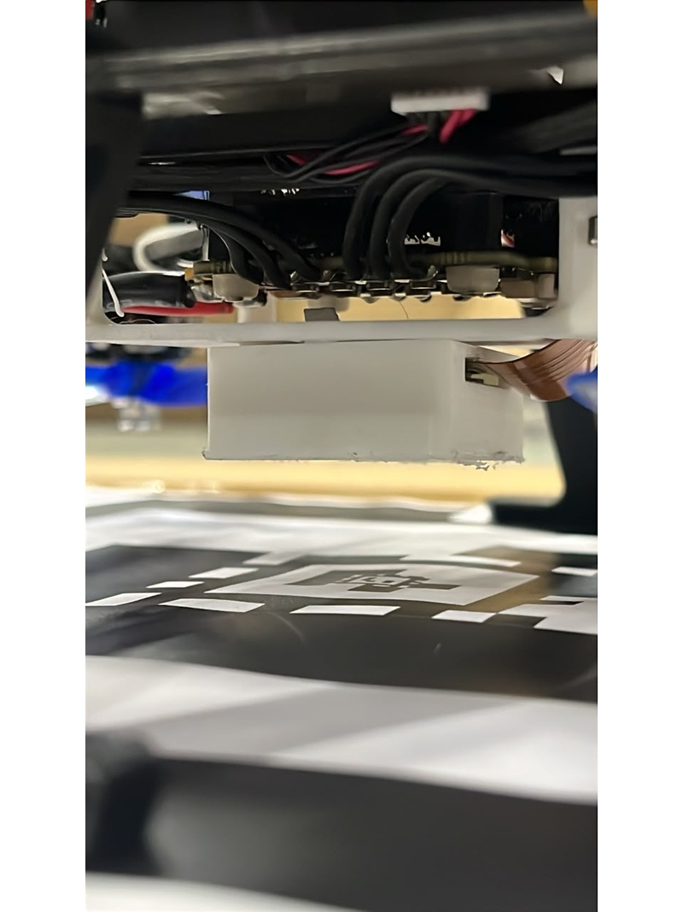
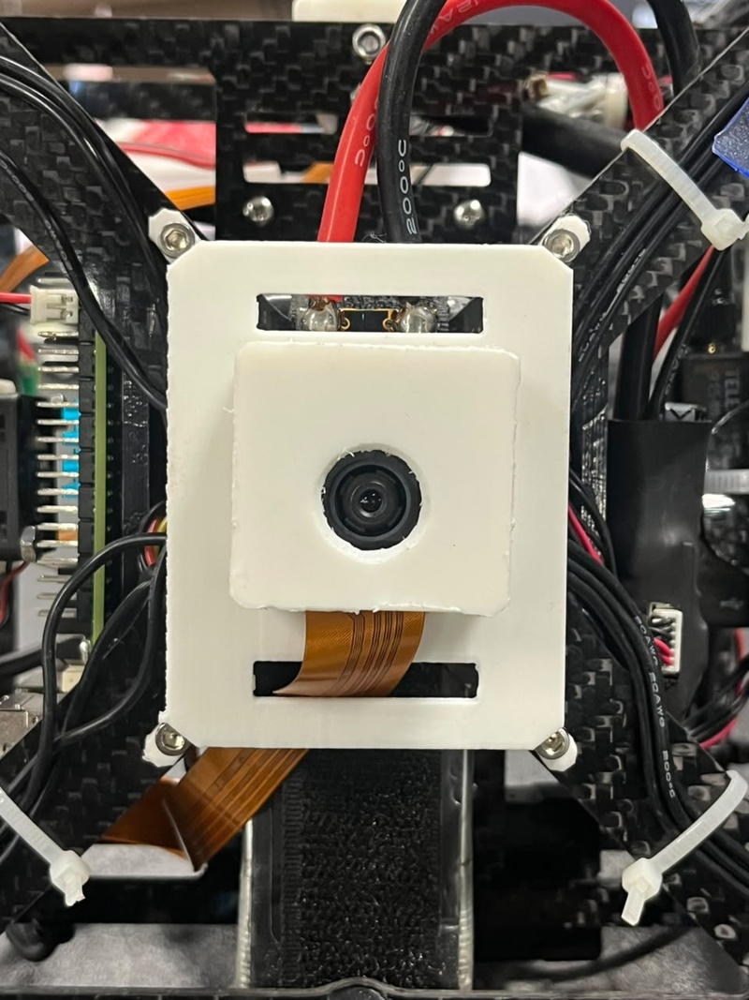
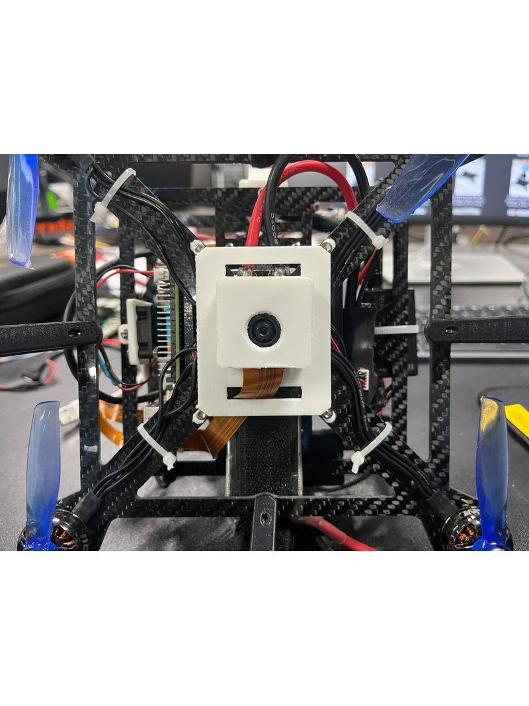

# Vision-Based Precision Landing for ArduPilot (ROS 2 Humble)

<div align="center">

[](https://docs.ros.org/en/humble/)
[](https://ardupilot.org/copter/)
[](https://gazebosim.org/)
[](docs/hardware/README.md)
[](LICENSE)

**An end-to-end, fully autonomous vision-guided takeoff, GPS waypoint transit, and precision landing pipeline for ArduCopter multirotors, engineered with ROS 2 Humble, MAVROS, and concentric nested AprilTag fiducial tracking.**

</div>

---

> [!CAUTION]
> **CRITICAL FLIGHT SAFETY WARNING: Read [SAFETY.md](SAFETY.md) before powering the drone.**  
> With this stack running, switching the flight controller to **GUIDED mode automatically arms the vehicle, initiates takeoff, and executes the mission**. Always configure a hardware emergency motor-stop kill switch and maintain line-of-sight pilot override capability.

---

<p align="center">
  
  <br>
  <em>Autonomous precision touchdown: Fury quadcopter centered squarely on the concentric nested AprilTag target.</em>
</p>

<p align="center">
  
  <br>
  <em>Real-world outdoor flight validation: AprilTag visual lock, descent velocity regulation, and terminal touchdown.</em>
</p>

---

## Executive Overview

Standard GNSS-based waypoint navigation provides positioning accuracy typically limited to $\pm 1.5\text{ to }3.0\text{ meters}$, which is inadequate for constrained drop zones, charging pads, or automated docking stations. 

This repository delivers a complete, production-grade vision-based flight autonomy stack for ArduPilot multirotors:
- **Centimeter-Level Touchdown Accuracy**: Replaces GPS uncertainty with a closed-loop visual PID velocity controller during the descent phase.
- **Concentric Nested AprilTags (Family 48h12)**: Solves the monocular scale dilemma by nesting three tags inside one another (22.7 cm, 4.5 cm, and 1.6 cm), providing unbroken visual tracking from 12 meters altitude down to touchdown.
- **Robust Fail-Safe State Machine**: Continuously monitors MAVROS heartbeat, visual tracking continuity, and command execution, immediately initiating Return-to-Launch (RTL) upon anomalies.
- **Hardware Agnostic & Flexible Deployment**: Validated on Raspberry Pi 5 (containerized via Docker) and Raspberry Pi 4 (native bare-metal Ubuntu 22.04 LTS).

---

## Mission Workflow



1. **Trigger**: Pilot switches the RC transmitter to **GUIDED** mode.
2. **Takeoff**: `mission_executive` arms the motors and commands takeoff to the configured cruise altitude (`takeoff_alt`, default 6.0 m).
3. **Transit**: `navigation_server` publishes global setpoints to fly to destination coordinates (`target_lat`, `target_lon`).
4. **Target Acquisition & Handover**: Upon arrival within 1.5 m of the waypoint, `landing_server` acquires the concentric AprilTag (Outer Tag 0) and commences descent.
5. **Terminal Descent**: As the drone approaches ground level, visual priority smoothly hands off from Tag 0 to Tag 1, and finally Tag 2, maintaining zero-pixel centering.
6. **Touchdown**: Below $0.4\text{ m}$, the stack triggers native `LAND` mode for touchdown and automatic motor shutdown.

---

## Performance & Detection Capabilities

| Camera Configuration | Max Target Acquisition Altitude | Primary Marker Dimension | Ground Field of View (FOV) |
| :--- | :---: | :---: | :---: |
| **Sony IMX500 (640 $\times$ 480)** | **7 – 8 m** | 22.7 cm outer tag (`ID 0`, 48h12) | $\approx 9.6\text{ m} \times 7.2\text{ m}$ at 8m |
| **Sony IMX500 (1280 $\times$ 720)**| **10 – 12 m** | 22.7 cm outer tag (`ID 0`, 48h12) | $\approx 14.5\text{ m} \times 8.2\text{ m}$ at 12m |

*For complete optical derivations and camera geometry, see [docs/detection-range.md](docs/detection-range.md).*

### Touchdown Alignment

| Side Profile | Top-Down Alignment | Field Flight Setup |
| :---: | :---: | :---: |
|  |  |  |
| *Landing gear centered on pad* | *Target center aligned to optical axis* | *Field deployment on grass terrain* |

---

## System Architecture

```text
Sony IMX500 Camera ----(CSI / CAM0)----> Camera Node ----> /camera/image_raw (30 Hz)
                                                                 |
                                                                 v
                                                          apriltag_ros
                                                                 |
                                                                 v
RC Mode Switch (GUIDED)                                     /detections
          |                                                      |
          v                                                      v
     Cube Orange+ <==== TELEM 2 (Serial / USB) ====> MAVROS <====+
          ^                                              |
          |       /mavros/setpoint_raw/global            |
          +<---------------------------------- navigation_server
          |       /mavros/setpoint_velocity/cmd_vel      |
          +<---------------------------------- landing_server
          |       Arm / Takeoff / Mode Services          |
          +<---------------------------------- mission_executive
```

---

## Hardware Overview

| Component | Project Implementation | Notes & Specifications |
| :--- | :--- | :--- |
| **Flight Controller** | Cube Orange+ (ArduCopter 4.3+) | Connected via carrier board `TELEM 2` to companion USB at 921600 baud. |
| **Companion Computer** | Raspberry Pi 5 (8 GB) *(or Pi 4)* | Pi 5 runs RPi OS + Docker; Pi 4 runs Ubuntu 22.04 LTS native bare-metal. |
| **Vision Sensor** | Sony IMX500 AI Camera Module | Fixed nadir (straight-down) orientation via 500 mm FPC ribbon cable. |
| **Camera Mount** | 3D-Printed PLA/PETG Enclosure | Custom Onshape CAD design with vibration isolation ([camera-holder](docs/hardware/camera-holder/README.md)). |
| **Power Distribution** | Dual Independent Regulation | 2200 mAh 40C LiPo $\rightarrow$ Cube Brick Mini (FCU) & 5V 5A Buck (Pi 5). |
| **Telemetry Link** | TP-Link USB High-Gain Wi-Fi | Provides ground GCS link, remote SSH access, and GStreamer video downlink. |

| Downward Camera Enclosure | Undercarriage Airframe Integration |
| :---: | :---: |
|  |  |
| *Sony IMX500 camera secured in 3D-printed enclosure* | *Undercarriage view showing clean cable routing clear of propellers* |

*For complete wiring schematics, interconnect diagrams, and electrical warnings, see [docs/hardware/README.md](docs/hardware/README.md).*

---

## Quick Start Guide

1. **Review Safety Protocols**: Read [SAFETY.md](SAFETY.md) and configure a physical motor-kill switch.
2. **Assemble Hardware & Avionics**: Follow [docs/hardware/README.md](docs/hardware/README.md) and 3D print the [camera mount](docs/hardware/camera-holder/README.md).
3. **Install Dependencies & MAVROS**: Follow [docs/software/installation-and-mavros.md](docs/software/installation-and-mavros.md) for Pi 4 (bare-metal) or Pi 5 (Docker).
4. **Print Landing Target**: Fabricate the concentric 48h12 nested AprilTag pad per [docs/tags.md](docs/tags.md).
5. **Configure Mission Settings**: Edit [`src/autonomous_flight_stack/config/params.yaml`](src/autonomous_flight_stack/config/params.yaml) with your test GPS coordinates.
6. **Validate in Simulation First**: Execute the mission in Gazebo SITL per [docs/simulation.md](docs/simulation.md).
7. **Perform Bench & Flight Tests**: Follow the pre-flight verification checklist in [docs/software/README.md](docs/software/README.md).

---

## Documentation Roadmap

Follow this sequential workflow to assemble, configure, simulate, and fly the autonomous precision landing system:

| Step | Document | Focus Area |
| :---: | :--- | :--- |
| **01** | [SAFETY.md](SAFETY.md) | **Safety First**: Pre-arm safety checklists and emergency motor-kill switch setup |
| **02** | [docs/hardware/README.md](docs/hardware/README.md) | **Hardware & Wiring**: Electrical interconnect diagram, 5V/5A power bus, and CSI routing |
| **03** | [docs/hardware/camera-holder/README.md](docs/hardware/camera-holder/README.md) | **Camera Mount**: 3D-printed CAD models, print settings, and nadir alignment |
| **04** | [docs/tags.md](docs/tags.md) | **Target Design**: Concentric 48h12 nested tags vs single tags, sizing, and printing |
| **05** | [docs/detection-range.md](docs/detection-range.md) | **Detection Range**: Optical geometry, field of view, and maximum altitude equations |
| **06** | [docs/simulation.md](docs/simulation.md) | **SITL Simulation**: Gazebo runway, RViz coordinate tracking, and QGC camera setup |
| **07** | [docs/software/installation-and-mavros.md](docs/software/installation-and-mavros.md) | **Installation & MAVROS**: Package installs, GeographicLib, and Pi 4 / Pi 5 architectures |
| **08** | [docs/software/README.md](docs/software/README.md) | **Software Stack**: System architecture, runtime execution, and pre-flight tests |
| **09** | [docs/software/nodes.md](docs/software/nodes.md) | **ROS 2 Nodes**: In-depth node architecture, action definitions, and topic interfaces |
| **10** | [docs/software/config.md](docs/software/config.md) | **Configuration**: Complete parameter tuning reference for `params.yaml` |
| **11** | [docs/landing-algorithm.md](docs/landing-algorithm.md) | **Landing Logic**: State machine phases, PID descent control, and touchdown detection |
| **12** | [docs/troubleshooting.md](docs/troubleshooting.md) | **Troubleshooting**: Diagnostic fault matrix for telemetry, vision, and flight issues |
| **13** | [docs/known-issues.md](docs/known-issues.md) | **Known Issues**: Active firmware considerations and technical limitations |

---

## Repository Structure

```text
pr_land_ws/
├── README.md                                         # Main project hero overview and roadmap
├── SAFETY.md                                         # Flight safety protocols & kill switch setup
├── LICENSE                                           # MIT open-source license
├── test_pr_land_02.py                                # Standalone bench diagnostic & test script
├── gstream_pi_cam.py                                 # Low-latency GStreamer H.264 video downlink
├── src/
│   ├── uav_interfaces/                               # ROS 2 custom action definitions
│   │   ├── action/NavigateToWaypoint.action          # GPS waypoint transit action
│   │   └── action/PrecisionLand.action               # Vision-based precision landing action
│   └── autonomous_flight_stack/                      # Core autonomous mission package
│       ├── config/params.yaml                        # Mission GPS coordinates & PID tuning
│       ├── launch/uav_core.launch.py                 # Unified ROS 2 multi-node launch file
│       └── scripts/
│           ├── mission_executive.py                  # Flight coordinator (arm, takeoff, failsafes)
│           ├── navigation_server.py                  # GPS waypoint navigation action server
│           └── landing_server.py                     # AprilTag visual PID landing action server
└── docs/                                             # Step-by-step modular documentation
    ├── hardware/                                     # Electrical, carrier board, and BEC guides
    │   ├── connection_diagram/                       # High-res companion computer interconnect diagram
    │   └── camera-holder/                            # CAD STL/STEP files and assembly guide
    ├── simulation.md                                 # Gazebo, RViz, and QGC SITL simulation guide
    ├── tags.md                                       # Concentric nested AprilTag specifications
    └── software/                                     # Software installation, nodes, and config guides
```

---

## License

This project is licensed under the MIT License — see the [LICENSE](LICENSE) file for details.

Developed by **Abhin M** for **ICFOSS**.

---

<div align="center">

| 📖 Documentation Guide | ➡️ [**Start Step 01: Safety Guide (SAFETY.md)**](SAFETY.md) |
| :---: | :---: |

</div>
