# Hardware Setup & Wiring

Everything you need to build the companion computer, avionics, and electrical connections for autonomous precision landing. Read [../../SAFETY.md](../../SAFETY.md) before applying battery power.

---

## System Interconnect Diagram

The complete hardware interconnect between the Cube Orange+ flight controller, Raspberry Pi 5 companion computer, Sony IMX500 camera, and dual-regulated power distribution is illustrated below:

<p align="center">
  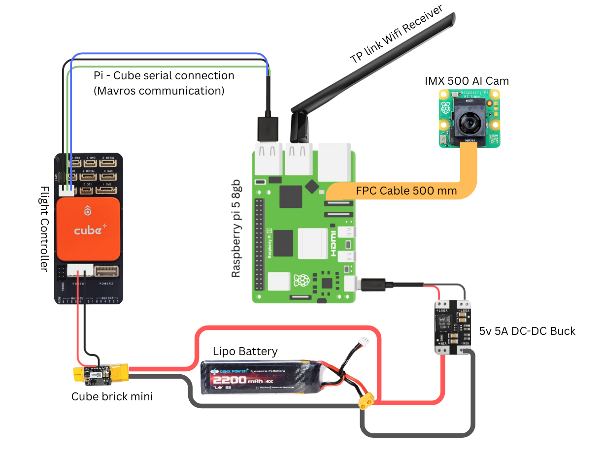
  <br>
  <em>Figure 1: Full avionics interconnect architecture — Cube Orange+ FCU, Raspberry Pi 5 (8 GB), IMX500 AI camera, 5V 5A buck regulator, and dual-branch LiPo power bus.</em>
</p>

### Connection Subsystems Breakdown

1. **Companion Computer & FCU Telemetry Link (MAVROS)**:
   - **Cube Port**: `TELEM 2` on the carrier board (3-wire: TX, RX, GND).
   - **Pi Port**: USB-A port on the Raspberry Pi 5 via a custom spliced USB-to-UART serial cable.
   - **Serial Device**: Typically appears as `/dev/ttyUSB0` or `/dev/ttyACM0` on the Pi host.
   - **Communication Protocol**: MAVLink 2 at 921600 baud (`SERIAL2_BAUD = 921`, `SERIAL2_PROTOCOL = 2`).
2. **Vision Subsystem (CSI Interface)**:
   - **Camera**: Sony IMX500 AI Camera Module mounted in the 3D-printed nadir enclosure.
   - **Ribbon Cable**: **500 mm flexible flat cable (FPC)** (Standard 15-pin to Mini 22-pin pitch adapter).
   - **Pi Port**: Connected to the Raspberry Pi 5 **CAM0** CSI connector with contacts facing towards the latch.
3. **Dual-Regulated Power Distribution**:
   - **Battery Source**: 2200 mAh 40C LiPo battery connected via an XT60 parallel splitter.
   - **FCU Power Branch**: Powers the **Cube Brick Mini** power module, providing monitored 5.3 V to the Cube's **POWER1** port with voltage and current sensing telemetry.
   - **Companion Computer Branch**: Powers a dedicated **5V 5A DC-DC Buck Converter**, which outputs regulated 5.0 V / 5.0 A through a USB-C plug directly into the Pi 5 power input.
4. **Wireless Ground Station & Telemetry (GCS Link)**:
   - **Wi-Fi Dongle**: High-gain **TP-Link AC1300 Dual-Band USB Wi-Fi Receiver** with external antenna plugged into a Raspberry Pi 5 USB 3.0 port.
   - **Function**: Enables high-bandwidth field connectivity for remote SSH terminals, ROS 2 distributed DDS topics, and live GStreamer video downlink (`gstream_pi_cam.py`) to the ground control laptop.

---

## Parts List

| Component | Hardware Specification | Function & Notes |
| :--- | :--- | :--- |
| **Flight Controller** | Cube Orange+ (ADS-B / Standard Carrier Board) | Runs ArduCopter firmware (v4.3+). Executes low-level PID attitude, position control, and motor mixing. |
| **Companion Computer** | Raspberry Pi 5 (8 GB RAM) *(or Raspberry Pi 4 Model B)* | Runs the autonomous flight stack, MAVROS bridge, and AprilTag detection nodes. |
| **Vision Sensor** | Sony IMX500 AI Camera Module | Fixed nadir (straight-down) orientation. Publishes 640x480 / 1280x720 video frames at 30 fps. |
| **Camera Ribbon** | 500 mm FPC CSI Ribbon Cable (15-pin to 22-pin) | Connects camera to Pi 5 `CAM0` port with sufficient flex for airframe mounting. |
| **Camera Mount** | 3D-printed 2-piece PLA/PETG enclosure & base | Custom CAD mount designed in Onshape (see [camera-holder](camera-holder/README.md)). |
| **Telemetry Wi-Fi** | TP-Link AC1300 High-Gain USB Wi-Fi Receiver | Ground-to-air telemetry, live terminal diagnostics, and GStreamer video stream. |
| **Companion Power** | 5 V / 5 A DC-DC Buck Converter (USB-C termination) | Dedicated power supply for Raspberry Pi 5. **5 A minimum is strictly required**. |
| **Autopilot Power** | Cube Power Brick Mini Module | Dedicated power module for Cube Orange+ `POWER1` port with voltage/current sensing. |
| **Battery Bus** | 4S 2200 mAh 40C LiPo Battery | Central flight and companion power source (14.8 V nominal, 15.4 V resting) with XT60 splitter. |
| **Serial Link Cable**| Custom TELEM 2 (JST-GH) to USB Data Cable | Bridges Cube Orange+ TELEM 2 UART to Pi 5 USB port for MAVROS. |
| **RC Transmitter/Rx** | RadioLink AT9S Pro (or RadioMaster TX16S) + Receiver | Primary manual pilot override and GUIDED mode switch. Screen displays live telemetry & mode. |
| **GNSS & Compass** | External GPS + Magnetometer (Here3 / Here4) | Provides global RTK/GPS fix for GPS waypoint navigation. |

---

## Parts & Components Gallery

### 1. Core Processing & Avionics
| Cube Orange+ (Box) | Raspberry Pi 5 (8 GB) Board | Sony IMX500 AI Camera |
| :---: | :---: | :---: |
| 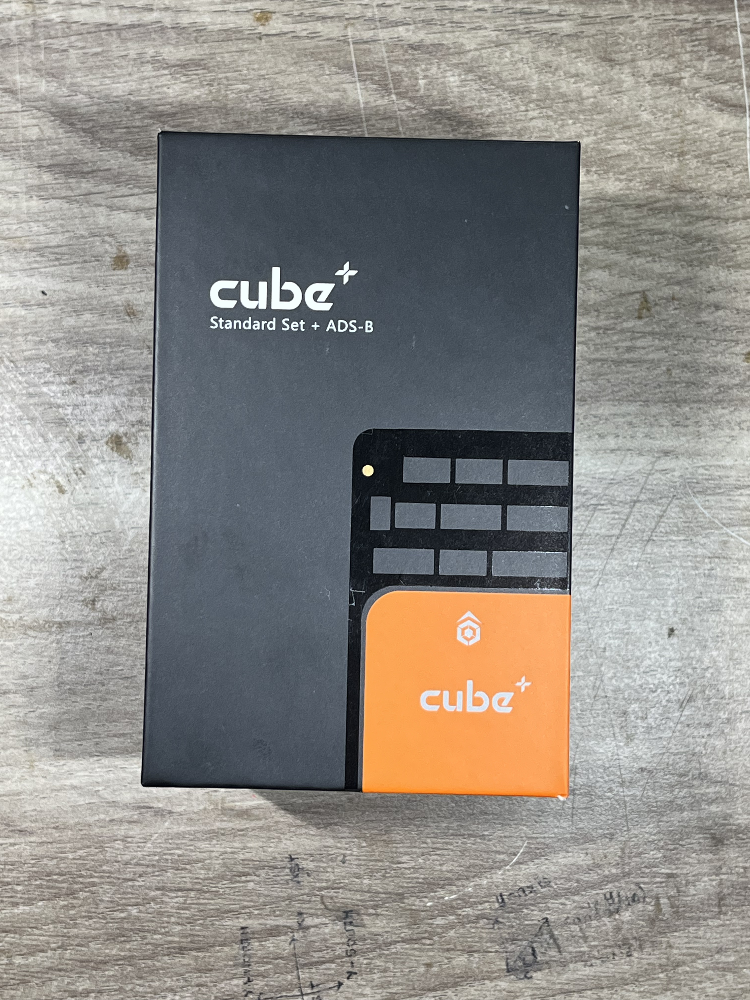 | 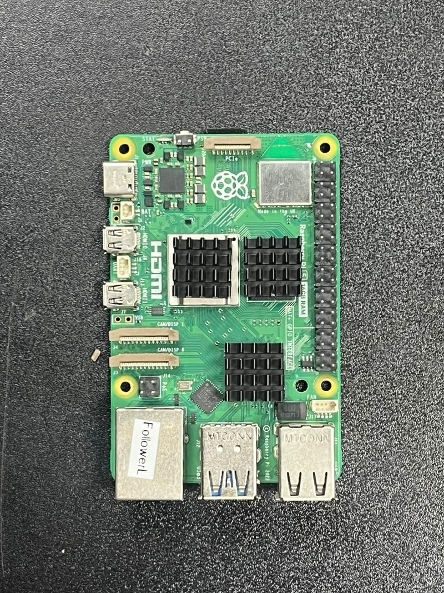 | 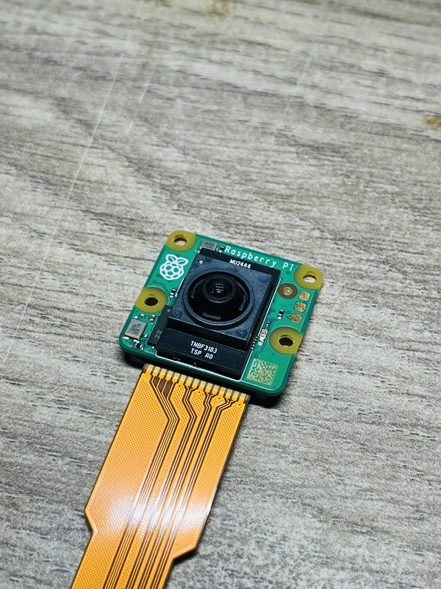 |
| *Cube Orange+ autopilot packaging* | *Raspberry Pi 5 (8 GB) with passive heatsinks* | *Sony IMX500 AI camera module* |

### 2. Connectivity, Telemetry & Pilot Control
| RadioLink AT9S Pro Transmitter | TP-Link AC1300 USB Wi-Fi Receiver | FPC Camera Ribbons (200mm vs 500mm) |
| :---: | :---: | :---: |
| 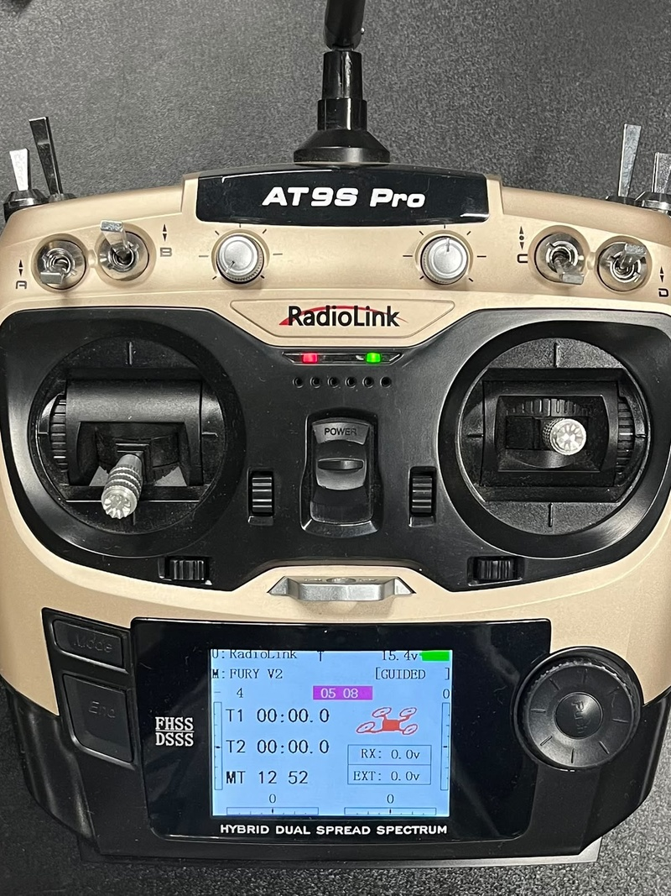 | 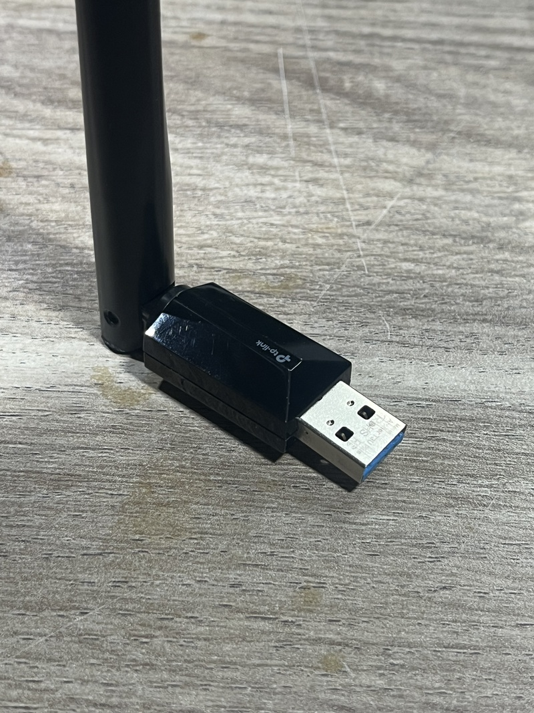 | 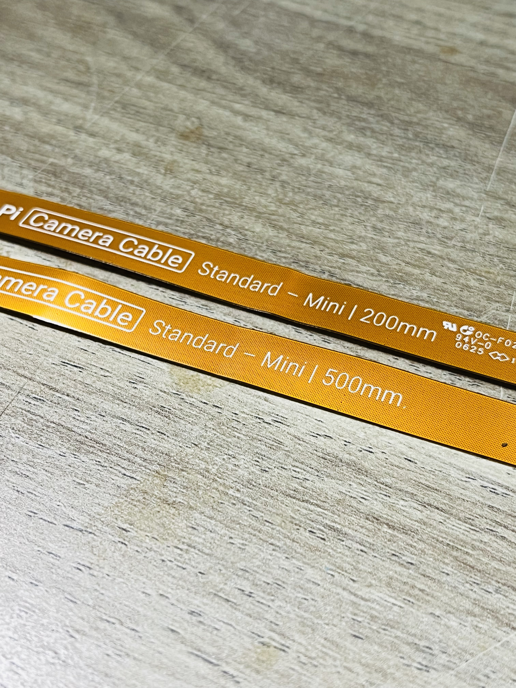 |
| *RadioLink AT9S Pro transmitter (FURY V2 in GUIDED mode, 15.4V telemetry)* | *High-gain dual-band AC1300 USB Wi-Fi adapter* | *Official Standard-to-Mini CSI ribbon cables* |

> [!NOTE]
> **Pilot Override & Mode Telemetry**: The RadioLink AT9S Pro transmitter is configured for the **FURY V2** model profile. As seen on the LCD display, it receives real-time flight mode telemetry (`[GUIDED]`) and 4S LiPo pack voltage (`15.4 V`). RadioMaster TX16S is also supported as an alternate multi-protocol transmitter.

### 3. Custom MAVROS Serial Cable Harness
| TELEM 2 to USB Custom Harness | Stock Extender vs Custom Spliced Cable | Cube Carrier Board USB Wiring |
| :---: | :---: | :---: |
| 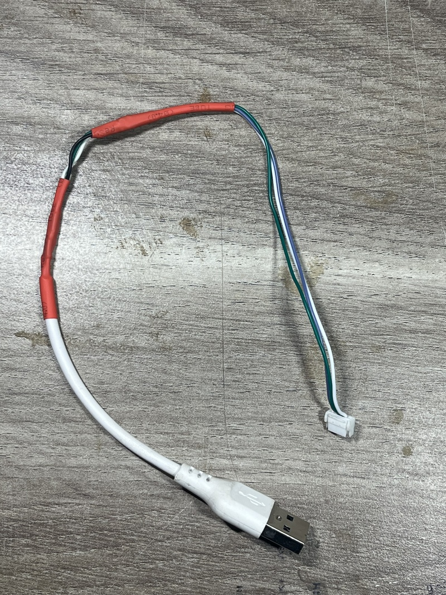 | 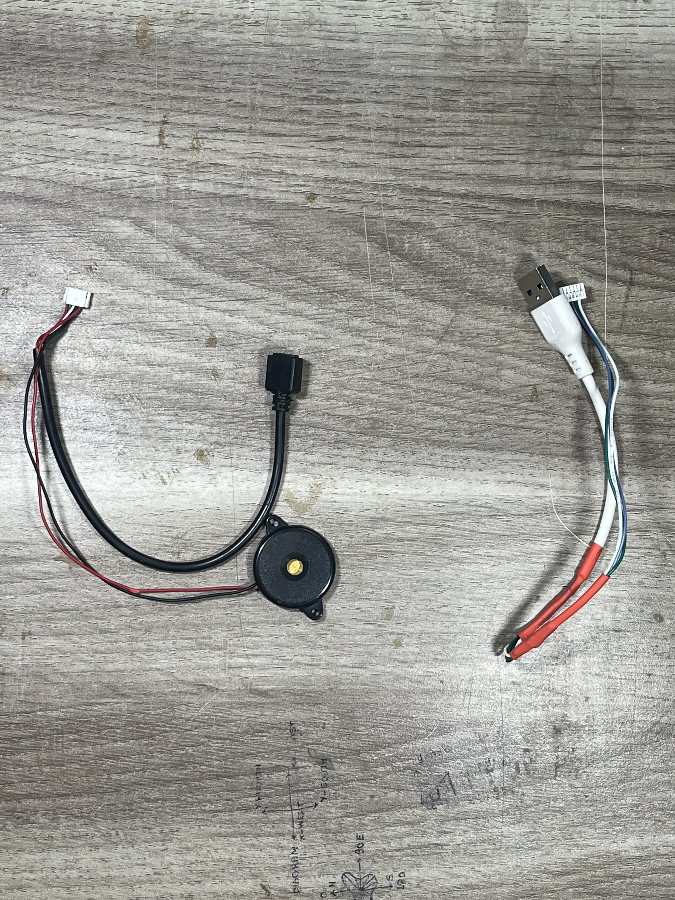 | 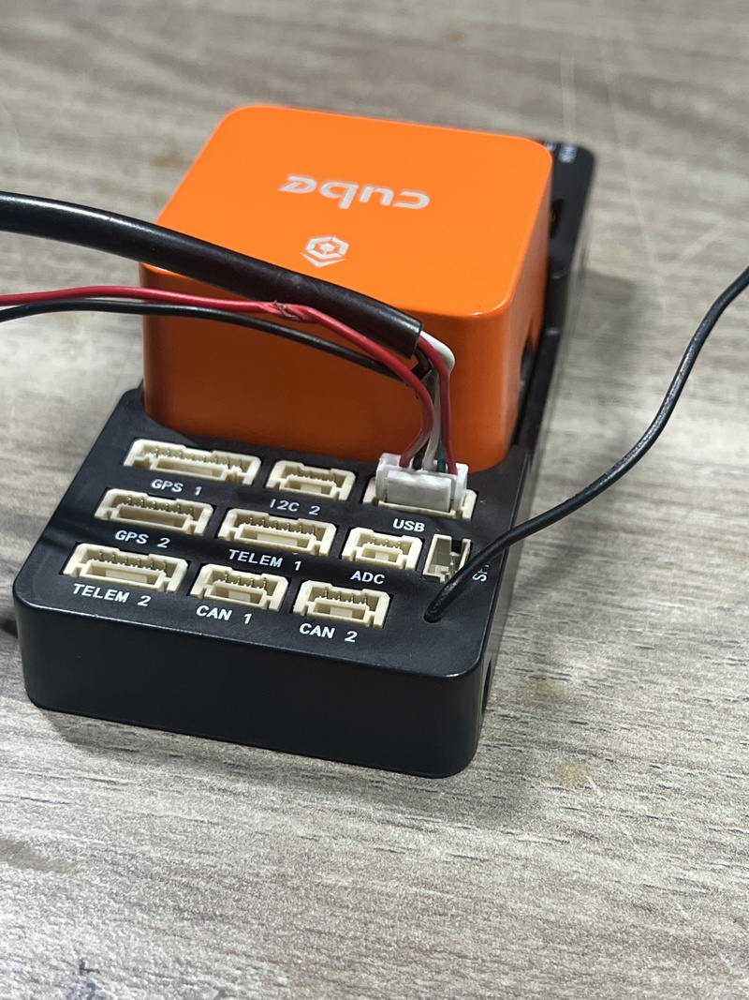 |
| *Custom JST-GH to USB-A serial cable harness* | *Left: Stock Cube USB/buzzer lead; Right: Custom low-profile serial harness* | *Close-up of carrier board USB & serial connectors* |

> [!TIP]
> **Custom Telemetry Cable Construction**: As shown in the comparison photo above, the standard USB extension cable supplied with the Cube is bulky. For clean undercarriage airframe integration, a custom harness was constructed by splicing a standard shielded USB-A cable directly to a 6-pin JST-GH connector (`TELEM 2`: TX, RX, GND) and insulating each solder junction with dual-wall heat-shrink tubing.

### 4. Power Regulation & Multimeter Verification
| 5V 5A DC-DC Buck Converter Assembly | Bare 5V 5A DC-DC Buck Regulator PCB | Multimeter 5.1V Rail Verification |
| :---: | :---: | :---: |
| 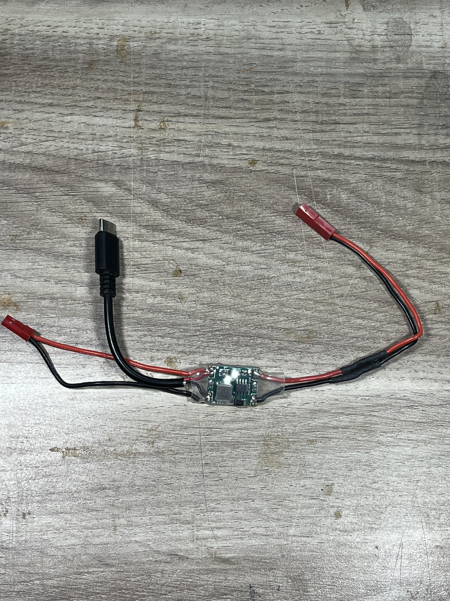 | 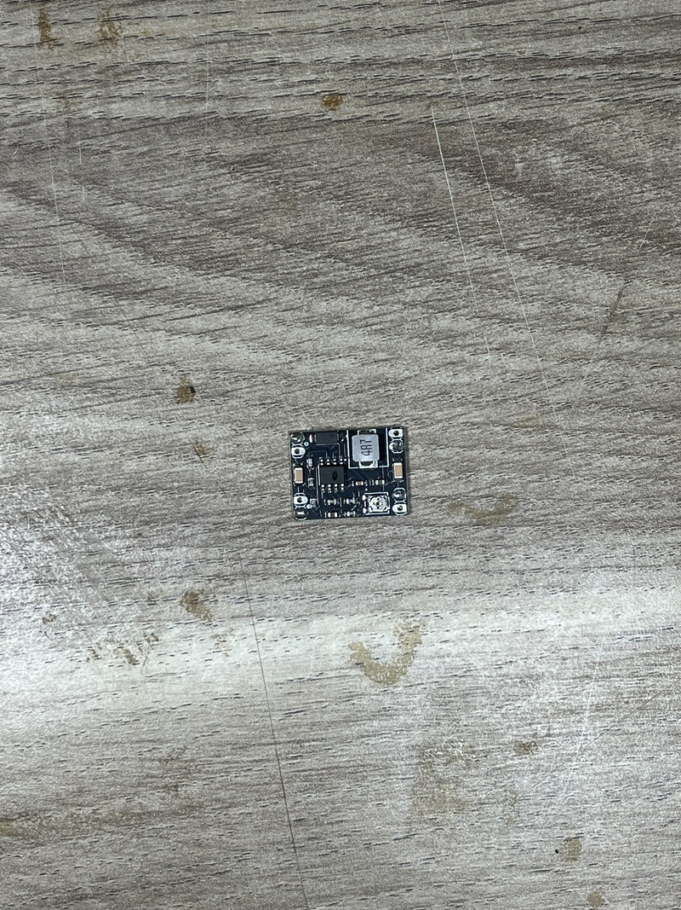 | 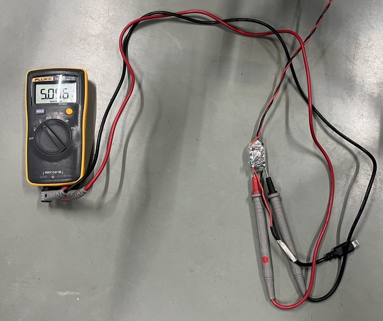 |
| *Complete 5V 5A buck converter with USB-C termination* | *High-efficiency step-down buck converter PCB module* | *Fluke digital multimeter verifying clean 5.096 V rail under load* |

---

## Power Distribution & Critical Voltage Warning

The Raspberry Pi 5 requires a regulated **5.0 V / 5.0 A** continuous power supply. Under high computational load (running the camera driver, GStreamer encoding, AprilTag detection pipeline, and multiple ROS 2 nodes simultaneously), an under-powered Pi 5 will suffer from voltage drops:

> [!CAUTION]
> **Brownout Hazard**: Never power the Raspberry Pi 5 from the Cube's 5V rail or an under-rated 5V/3A BEC. Voltage droop triggers aggressive CPU thermal/power throttling, USB bus reset, or complete system reboot mid-flight!

- **Verify Voltage**: Measure the output of the 5V 5A buck converter with a digital multimeter under load before plugging it into the Pi 5 USB-C port (must be between $5.0\text{ V} - 5.2\text{ V}$).
- **Check Throttling Flags**: On the Pi terminal, run:
  ```bash
  vcgencmd get_throttled
  ```
  A return value of `throttled=0x0` indicates clean, unthrottled power. Any bitmask containing `0x1` or `0x50000` indicates under-voltage history.

---

## Camera CSI Cable Installation (500 mm FPC)

The Sony IMX500 AI camera uses an official Raspberry Pi Standard-to-Mini CSI ribbon cable. While a 200 mm cable can be used for tight bench testing, the **500 mm cable** is strongly recommended for the physical drone to allow strain-free routing from the top-plate companion computer down to the nadir camera enclosure.

1. **Power Off**: Ensure the Raspberry Pi 5 is completely powered down before connecting or disconnecting the CSI ribbon.
2. **Port Selection**: Use the **CAM0** port on the Raspberry Pi 5.
3. **Insertion**:
   - Gently lift the brown/black locking collar of the CAM0 connector.
   - Insert the 500 mm ribbon cable squarely with the metallic contact pins facing towards the connector latch.
   - Press down on both edges of the locking collar until it clicks flush.
4. **Strain Relief**: Secure the 500 mm ribbon along the drone frame arms using zip-ties, leaving a gentle bend radius and keeping it completely clear of spinning propellers.

| Step 1: Insert Ribbon Cable | Step 2: Connect to CAM0 Port |
| :---: | :---: |
| 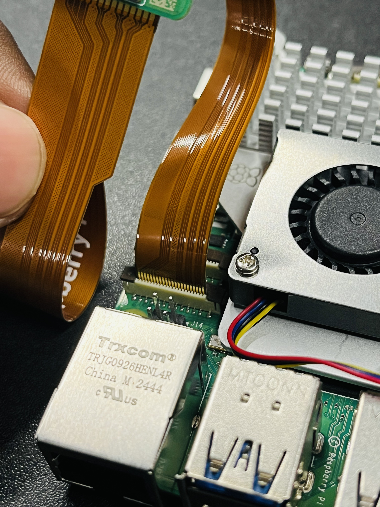 | 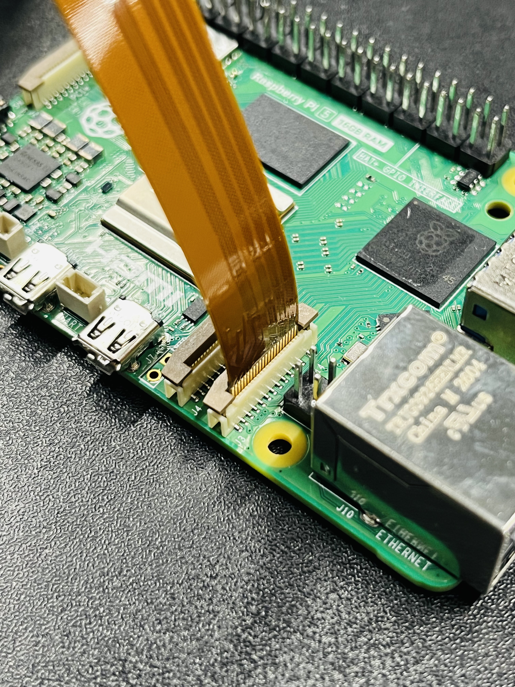 |
| *Lift connector latch and slide ribbon cable contacts in squarely* | *Firmly seat ribbon cable and lock CAM0 retention clip* |

---

## Flight Controller Configuration (ArduCopter)

1. **Firmware Installation**: Flash ArduCopter (v4.3.0 or later) via QGroundControl or Mission Planner.
2. **Sensors Calibration**: Perform accelerometer, compass, level horizon, and radio calibration.
3. **Telemetry Port Setup (TELEM 2)**:
   In the ArduCopter Full Parameter List, configure the serial port connected to the Pi:
   ```text
   SERIAL2_PROTOCOL = 2      (MAVLink 2)
   SERIAL2_BAUD     = 921    (921600 baud)
   BRD_SER2_RTSCTS  = 0      (Disabled if using 3-wire TX/RX/GND without flow control)
   ```
4. **Flight Mode Switch**: Assign a 2-position or 3-position switch on the RadioLink AT9S Pro (or RadioMaster TX16S) to **GUIDED** mode.
5. **Horizontal Speed Limit**: Set `WPNAV_SPEED = 500` (5.0 m/s) to ensure smooth transit to the precision landing search point.

> [!WARNING]
> **Auto-Takeoff on GUIDED**: As soon as the flight controller enters GUIDED mode, `mission_executive` immediately executes automatic arming and takeoff. Always keep fingers near the physical mode switch to revert instantly to **LOITER** or **STABILIZE**.

---

## Companion Computer Architecture: Pi 5 vs Pi 4

Depending on whether you deploy on a Raspberry Pi 5 or Raspberry Pi 4, the software deployment architecture differs:

* **Raspberry Pi 5 (Docker Required)**:
  - **Operating System**: Raspberry Pi OS (Bookworm, 64-bit).
  - **Reason**: Ubuntu 22.04 LTS lacks native kernel driver support for the IMX500 AI camera on the Raspberry Pi 5 CSI controller. Raspberry Pi OS handles the camera hardware, while the entire ROS 2 Humble stack, MAVROS, and detection pipeline run inside a containerized Ubuntu 22.04 Docker environment.
* **Raspberry Pi 4 (Bare-Metal / No Docker Needed)**:
  - **Operating System**: Ubuntu 22.04 LTS (Jammy, 64-bit).
  - **Native Setup**: Raspberry Pi 4 is fully supported natively by Ubuntu 22.04 LTS. **Users do not need Docker** on a Pi 4. All ROS 2 packages, MAVROS, and AprilTag dependencies are installed directly bare-metal.
  - **Installation Guide**: Detailed step-by-step terminal commands for bare-metal installation are provided in [docs/software/installation-and-mavros.md](../software/installation-and-mavros.md).

---

## Benchtop Integration & Pre-Flight Checklist

Before mounting hardware onto the drone frame, assemble the benchtop test setup to verify end-to-end communication:

| Bench Hardware Setup | Complete Interconnect with Telemetry Wi-Fi |
| :---: | :---: |
| 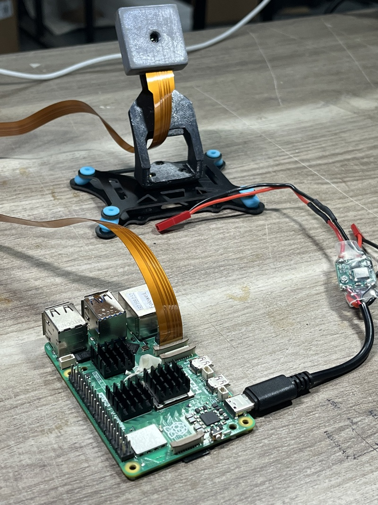 | 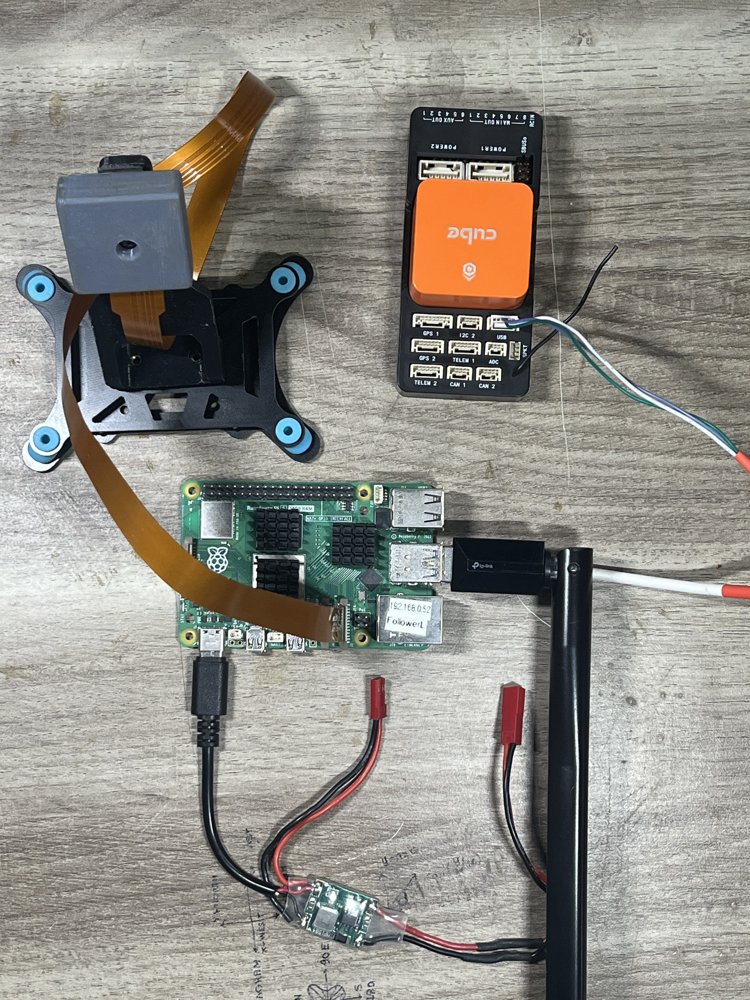 |
| *Raspberry Pi 5 with IMX500 AI camera and 5V BEC regulator* | *Full bench interconnect wiring with Wi-Fi dongle for telemetry link* |

### Pre-Power Bench Verification Checklist

- [ ] **Propellers Removed**: Ensure all propellers are off during bench testing.
- [ ] **Voltage Rail Verified**: Multimeter reads between 5.0 V and 5.2 V on the buck converter output.
- [ ] **Serial Recognition**: Running `ls /dev/ttyUSB*` or `ls /dev/ttyACM*` displays the Cube connection.
- [ ] **MAVROS Heartbeat**: `/mavros/state` publishes `connected: true` with valid heartbeat.
- [ ] **Camera Publishing**: Camera stream publishes at 30 fps on `/camera/image_raw`.
- [ ] **AprilTag Detection**: Placing target under the camera publishes valid arrays on `/detections`.
- [ ] **Optical Alignment**: Verified that image Top = Drone Nose (+X), image Left = Drone Left (+Y).

---

<div align="center">

| [⬅️ Previous: **01 - Safety Guide**](../../SAFETY.md) | [📖 **Documentation Roadmap**](../../README.md#documentation-roadmap) | [➡️ Next: **03 - Camera Holder Mount**](camera-holder/README.md) |
| :--- | :---: | ---: |

</div>
