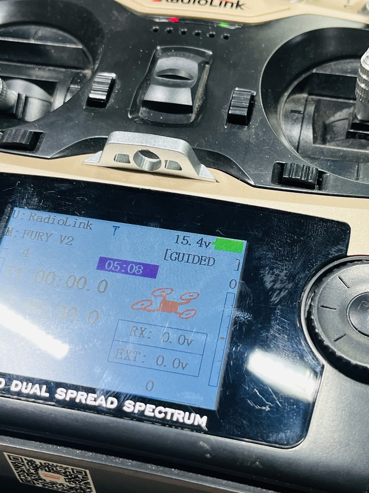
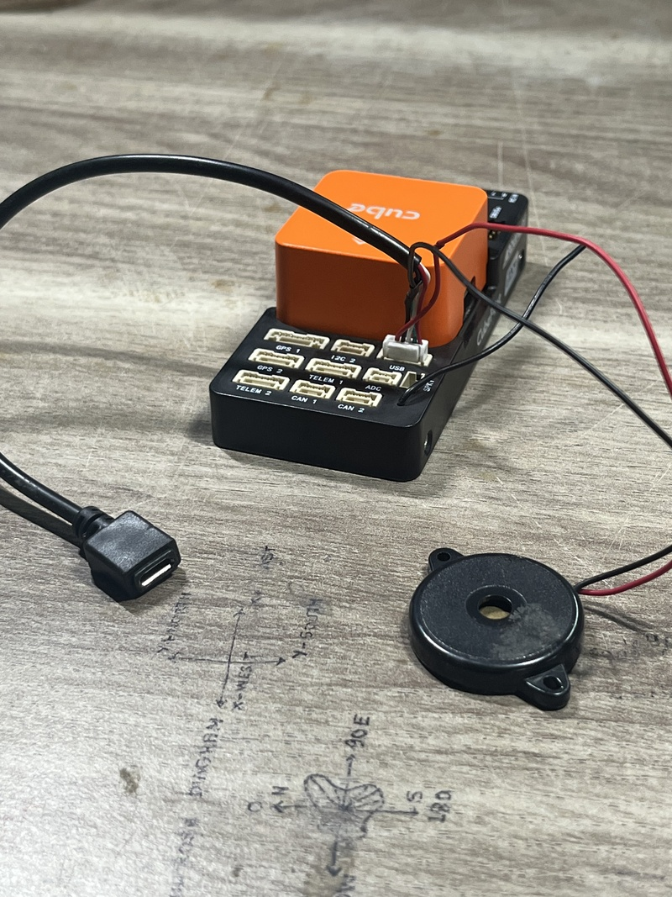

# Hardware

Everything you need to build the vehicle side of the system. Read [../../SAFETY.md](../../SAFETY.md) first.

## Parts

| Part | Used in this project | Notes |
| --- | --- | --- |
| Flight controller | Cube Orange+ | Runs ArduCopter. Firmware version: TODO |
| Companion computer | Raspberry Pi 5 | RAM size: TODO |
| Camera | IMX500 | Mounted facing straight down. Used as a normal camera feeding AprilTag detection |
| Camera holder | 3D-printed PLA | Onshape design, see [camera-holder](camera-holder/README.md) |
| GPS and compass | Required | Waypoint navigation uses GPS. Model: TODO |
| RC transmitter and receiver | Required | You switch modes with it, and it is your manual override |
| Pi power supply | 5 V buck converter from the battery | **5 V / 5 A is required for the Pi 5**, see the power warning below |
| Cube power | Power module from the same battery | Model: TODO |
| Battery | Single LiPo powers everything | Cell count and capacity: TODO |
| Cable | USB data cable, Cube USB port to a Pi 5 USB port | Must be a data cable, not charge-only |

### Parts photos

| Cube Orange+ (box) | IMX500 AI camera | RC transmitter (RadioMaster TX16S) |
| --- | --- | --- |
|  |  |  |

## Connections

```text
            LiPo battery
         +------+--------+
         |               |
   Power module      5 V buck converter (5 V / 5 A for the Pi 5)
         |               |
    Cube Orange+ <--USB--> Raspberry Pi 5 <--CSI--> IMX500 camera
         |
   GPS, RC receiver, ESCs
```

- MAVROS talks to the Cube over USB. The Cube normally appears on the Pi as `/dev/ttyACM0` (check with `ls /dev/ttyACM*`). Pass this device into the Docker container, see the Docker repository.
- The IMX500 connects to the Pi's CSI camera port.

| Cube carrier board USB wiring | Cube with safety switch, buzzer and USB extender to the Pi |
| --- | --- |
|  |  |

## Power warning

The Pi 5 needs a **5 V / 5 A** supply. The prototype was built with a 5 V / 3 A buck converter, which is below that requirement. An under-powered Pi 5 can throttle its CPU, reset, or drop USB devices in flight.

- Use a buck converter rated at least 5 V / 5 A, with a clean output.
- Check for power problems with `vcgencmd get_throttled` on the Pi host (`0x0` means no problems recorded).
- Test under full load (camera, detection, MAVROS running) on the ground before flying.

| BEC voltage regulator (USB-C output) | Checking the 5 V output with a multimeter |
| --- | --- |
|  |  |

Measure the BEC output with a multimeter before connecting the Pi, as in the photo.

## Connecting the camera (CSI)

Power the Pi off before touching the camera cable. Lift the connector latch, insert the ribbon cable fully with the contacts facing the correct way, and close the latch. The camera is connected to the **CAM0** port.

| Step 1: Insert Ribbon Cable | Step 2: Connect to CAM0 Port |
| :---: | :---: |
|  |  |
| *Lift latch and slide ribbon cable contacts in squarely* | *Firmly seat ribbon cable and lock CAM0 retention clip* |

TODO: confirm the cable length and the connector orientation you used.

## Flight controller setup

1. Flash ArduCopter and complete the standard setup in Mission Planner or QGroundControl: frame, accelerometer and compass calibration, radio calibration, motor test (propellers off).
2. Assign a switch on the RC transmitter to **GUIDED** mode.
3. The validated setup uses **no other parameter changes**. The stack itself triggers on GUIDED mode.
4. Optional: set the cruise speed with `WPNAV_SPEED` (cm/s). For 5-6 m/s use 500-600. The ArduCopter default is higher, so check the value on your firmware.

Safety note: because the stack arms and takes off as soon as it sees GUIDED mode, read [../../SAFETY.md](../../SAFETY.md) before assigning that switch.

## Raspberry Pi 5 host

The Pi runs **Raspberry Pi OS with Docker**. The ROS 2 Humble stack runs in an Ubuntu 22.04 container. The reason: the IMX500 camera has no firmware support on Ubuntu 22.04 for the CSI port, so the camera has to be handled by Raspberry Pi OS. Host setup, the Docker image and `docker compose` files are in a separate repository: TODO: add Docker repo link.

## Bench setup

The full bench setup (Raspberry Pi 5, IMX500, BEC, and Cube Orange+) before installing on the drone:

| Bench Hardware Setup | Complete Interconnect with Telemetry Wi-Fi |
| :---: | :---: |
|  |  |
| *Raspberry Pi 5 with IMX500 AI camera and 5V BEC regulator* | *Full bench interconnect wiring with Wi-Fi dongle for telemetry link* |

## Bench checklist

- [ ] Propellers off
- [ ] Battery connected, Pi boots, no under-voltage warning
- [ ] `ls /dev/ttyACM*` shows the Cube
- [ ] Camera image is visible and the tag is detected (`/detections` publishes)
- [ ] MAVROS shows `connected: true` on `/mavros/state`
- [ ] GPS lock outdoors, no pre-arm errors
- [ ] Camera orientation checked: image top = drone nose, image left = drone left (see [camera-holder](camera-holder/README.md))

---

<div align="center">

| [⬅️ Previous: **01 - Safety Guide**](../../SAFETY.md) | [📖 **Documentation Roadmap**](../../README.md#documentation-roadmap) | [➡️ Next: **03 - Camera Holder Mount**](camera-holder/README.md) |
| :--- | :---: | ---: |

</div>
