# IMX500 Top-Down Camera Holder

A custom 3D-printed mounting system designed in Onshape to secure the Sony IMX500 AI camera module firmly on the drone with a fixed nadir (straight-down) orientation.

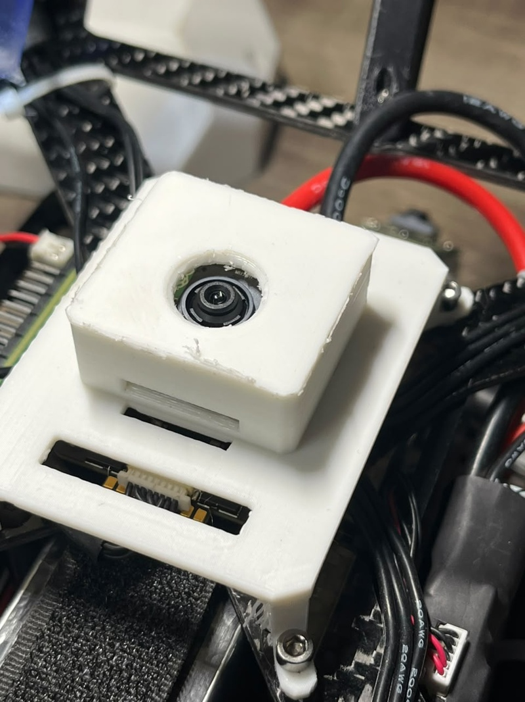

*Completed 3D-printed IMX500 camera enclosure and base mount.*

## CAD Designs

Designed in Onshape and exported for 3D printing. The assembly consists of two interlocking parts: the **Base Camera Holder** and the **Protective Enclosure**.

### Fully Assembled Mount
| Isometric View | Top View |
| :---: | :---: |
| 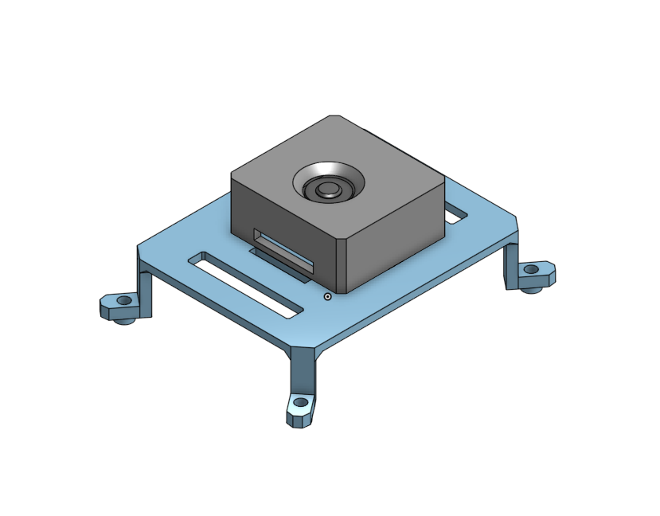 | 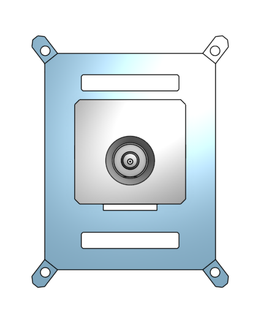 |

### Component Parts
| Base Holder (Isometric) | Base Holder (Top View) |
| :---: | :---: |
| 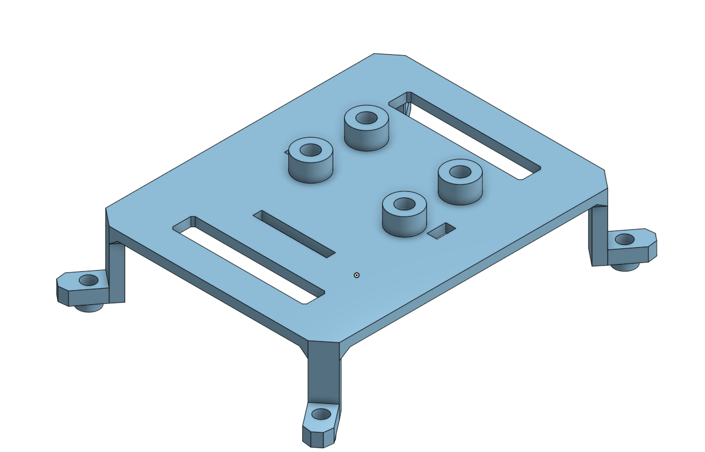 | 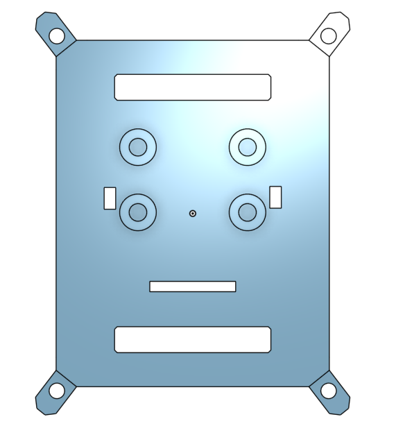 |

| Enclosure (Isometric) | Enclosure (Top View) | Enclosure (Bottom View) |
| :---: | :---: | :---: |
| 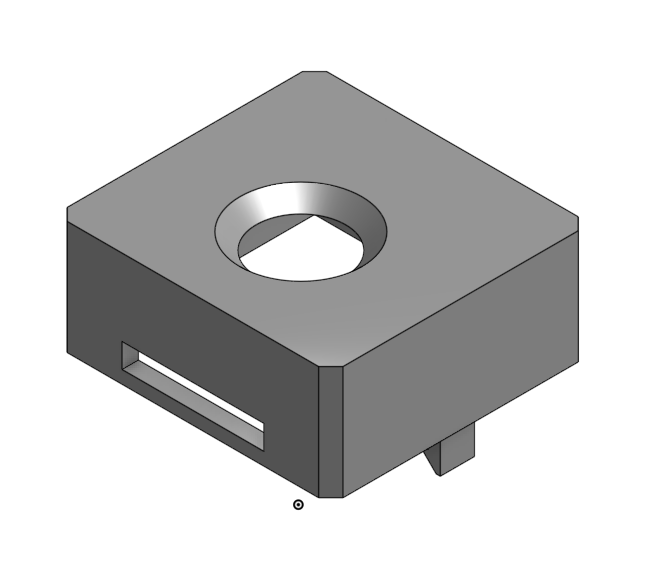 | 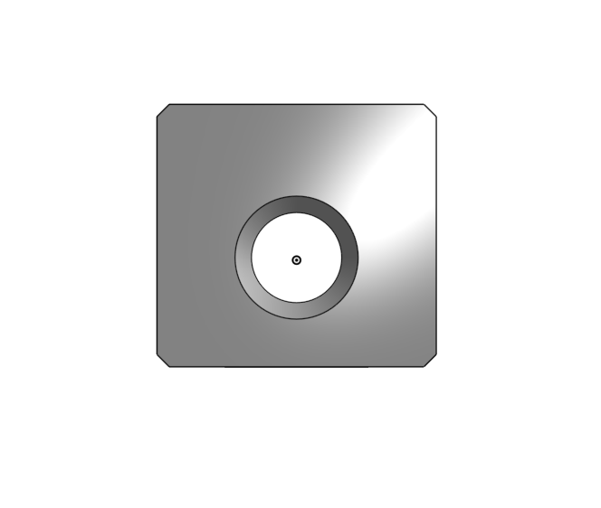 | 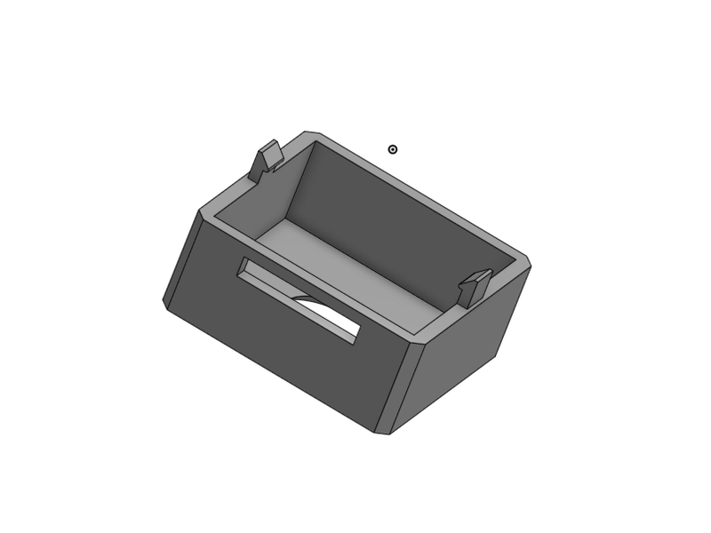 |

## Files

| File | Type | Description |
| --- | :---: | --- |
| [`cad/fury_imx500_holder.stl`](cad/fury_imx500_holder.stl) | Mesh | Base camera mount print-ready STL model |
| [`cad/fury_imx500_holder.step`](cad/fury_imx500_holder.step) | Solid | Base camera mount editable STEP CAD model |
| [`cad/imx500_fury_enclouser.stl`](cad/imx500_fury_enclouser.stl) | Mesh | Camera protective enclosure print-ready STL model |
| [`cad/imx500_fury_enclouser.step`](cad/imx500_fury_enclouser.step) | Solid | Camera protective enclosure editable STEP CAD model |
| Onshape Document | Cloud | Modelled in Onshape *(ICFOSS Drone Lab)* |

## Print Settings

| Setting | Recommended Value | Notes |
| --- | --- | --- |
| Material | PLA or PETG | Use PETG if operating in direct hot sunlight |
| Layer Height | 0.20 mm | Standard detail |
| Infill | 20% - 30% | Gyroid or Grid |
| Perimeters / Walls | 3 | Ensures screw holes hold threads without cracking |
| Supports | None or Touching Buildplate | Designed to print flat without internal supports |

## Hardware Needed

| Item | Specification | Quantity |
| --- | --- | :---: |
| Camera mounting screws | M2 x 6 mm Phillips machine screws | 4 |
| Camera mounting nuts | M2 hex nuts | 4 |
| Frame attachment | M3 bolts & nylon locknuts (or zip-ties) | 4 |

## Step-by-Step Assembly Guide

| Sequence | Photo | Details |
| :---: | :---: | --- |
| **Step 1 & 2** | 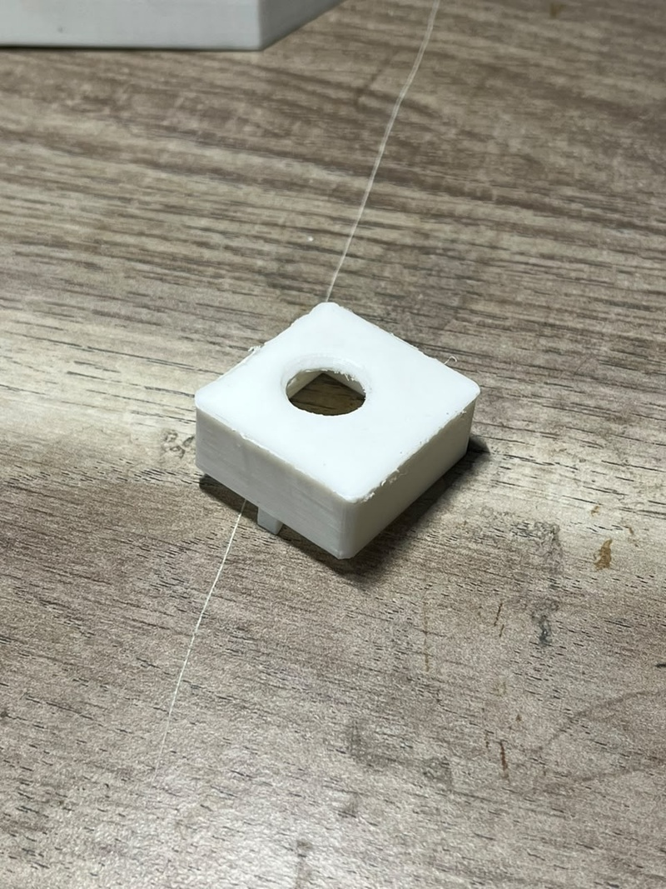 | **Inspect 3D Printed Parts**: Remove any brim, clean out screw holes, and verify the IMX500 camera module fits snugly into the enclosure recess. |
| **Step 3** | 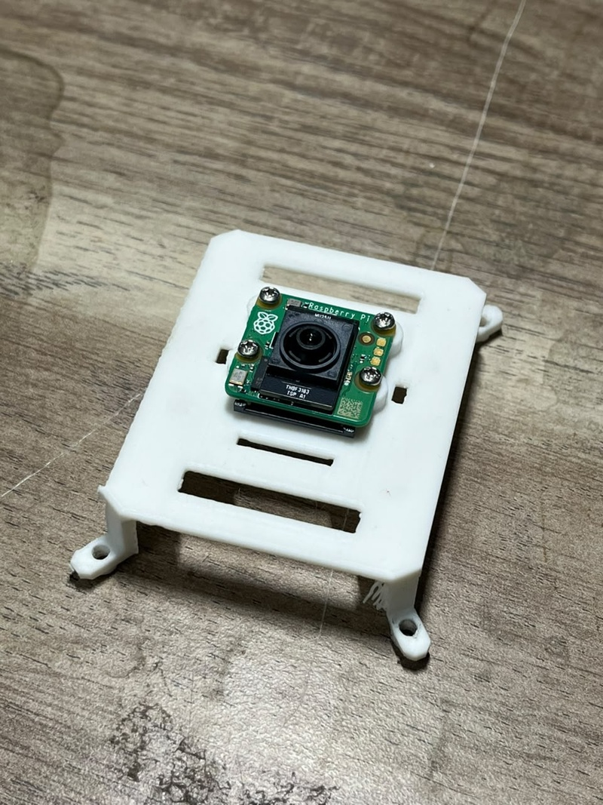 | **Install Camera in Enclosure**: Place the Sony IMX500 module into the mount and fasten it using four M2x6 mm Phillips machine screws and nuts. Do not over-tighten. |
| **Step 4** | 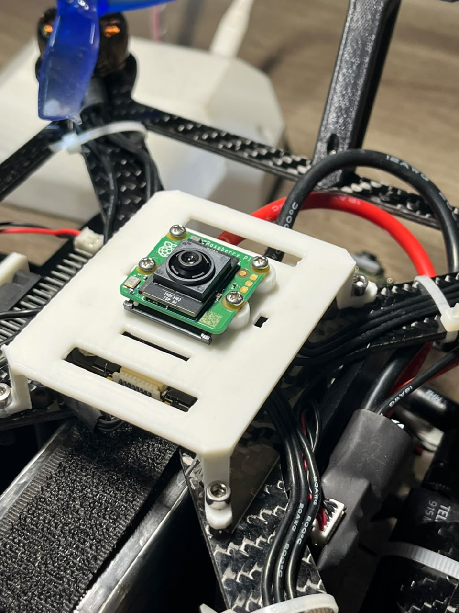 | **Mount Base to Drone Undercarriage**: Fasten the base holder securely to the lower bottom plate of the drone frame with screws aligned along the vehicle centerline. |
| **Step 5** |  | **Lock Enclosure to Base**: Fasten the camera enclosure onto the base holder, ensuring the lens is perpendicular to the drone's horizontal plane (facing true nadir). |
| **Step 6** | 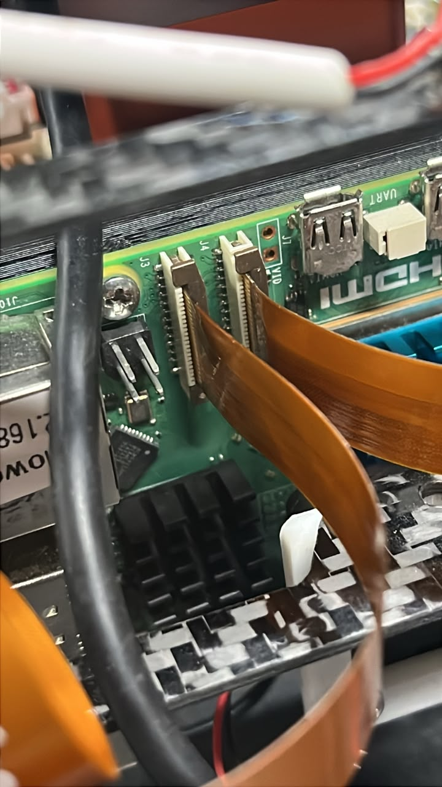 | **Route CSI Ribbon Cable**: Guide the 15-to-22 pin CSI ribbon cable smoothly up to the Raspberry Pi 5 CAM0 port without sharp kinks or proximity to rotating props. |

## Camera Orientation (Crucial for Control Loop)

The precision landing server assumes the following coordinate frame alignment:

- **Top of the image = Drone Nose (Forward, +X)**
- **Left of the image = Drone Left (+Y)**
- **Center of optical axis = True Nadir (-Z)**

This ensures error corrections directly map to velocity setpoints:
- Tag appearing in top half of image $\rightarrow$ Drone moves **Forward**.
- Tag appearing in left half of image $\rightarrow$ Drone moves **Left**.

If your physical mounting has the camera rotated $180^\circ$ or $90^\circ$, either physically flip the mount or update `sign_x` and `sign_y` in [../../../src/autonomous_flight_stack/config/params.yaml](../../../src/autonomous_flight_stack/config/params.yaml). Always verify on the bench before flight.

## Pre-Flight Checklist

- [ ] Camera holder is rigid with zero play/wobble on the frame
- [ ] Lens view is completely unobstructed by landing gear or prop disks
- [ ] Lens is cleaned and focused for nominal descent range
- [ ] CSI ribbon cable is strain-relieved and clear of propellers
- [ ] Orientation confirmed in software (`ros2 run rqt_image_view rqt_image_view`)

---

| [⬅️ Previous: **02 - Hardware Setup**](../README.md) | [📖 **Documentation Roadmap**](../../../README.md#documentation-roadmap) | [➡️ Next: **04 - Nested AprilTags**](../../tags.md) |
| :--- | :---: | ---: |

