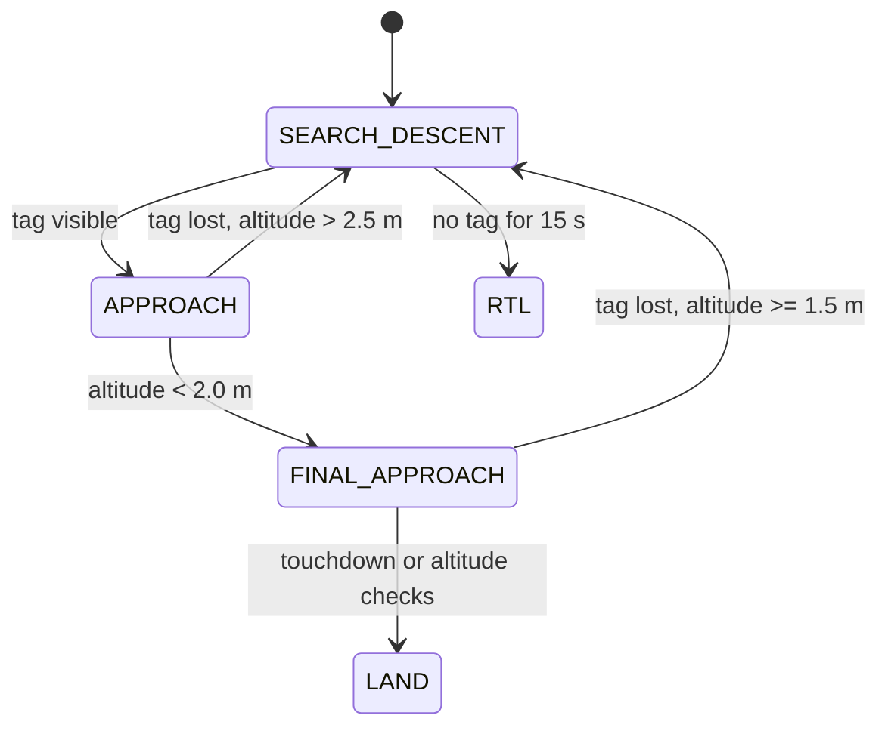

# Landing Algorithm

How `landing_server` takes the drone from the waypoint to the ground. It runs a 20 Hz control loop while the flight mode is GUIDED. Parameter names refer to [software/config.md](software/config.md).

## Phases



| Phase | Entered when | Behaviour |
| --- | --- | --- |
| SEARCH_DESCENT | Start of the goal, or tag lost | No tag: above 6 m descend at 0.3 m/s, from 6 m to 3 m descend at 0.15 m/s, below 3 m hold altitude. No horizontal motion |
| APPROACH | A listed tag is visible | Centre on the tag with PID and descend: 0.40 m/s above 4.5 m, 0.30 m/s to 3 m, 0.20 m/s to 2 m. Rotate to align yaw with the tag when the tag is within 120 px of the image centre |
| FINAL_APPROACH | Altitude below 2.0 m | PID gains scaled by 0.6, no yaw. Descend 0.25 m/s above 1 m, then 0.15 m/s |
| LAND | See below | Switches ArduPilot to LAND mode and reports success |

## Tag selection (nested tags)

Only tag IDs sent in the goal are used. If several are visible, the one with the **highest priority value** is tracked. As the drone descends, the large outer tag leaves the view or becomes undetectable, and the smaller inner tags take over. See [tags.md](tags.md).

## Control loop

The error is the tag centre's offset from the image centre, in pixels:

```text
err_x = (CX - tag_x) * sign_x        (left/right)
err_y = (CY - tag_y) * sign_y        (up/down in the image)
```

Velocity command in the drone body frame, with P, filtered D and integral terms:

```text
body_vx = (kp_fwd    * err_y + kd_fwd    * d(err_y)/dt + ki_xy * integral(err_y)) * gain_mult
body_vy = (kp_strafe * err_x + kd_strafe * d(err_x)/dt + ki_xy * integral(err_x)) * gain_mult
```

- The derivative is low-pass filtered (`d_filter_alpha`).
- The integral only accumulates when the error is below 100 px, is limited to plus or minus 5.0, and is reset when the tag is lost for more than 0.5 s or reacquired.
- `dt` is guarded so a scheduler hiccup cannot blow up the derivative.
- Body velocity is rotated by the current yaw into the local frame, clamped to `max_speed_mps` (0.5 m/s), and published to `/mavros/setpoint_velocity/cmd_vel_unstamped`.
- Yaw rate is `-tag_rotation_deg * kp_yaw * gain_mult`, only in APPROACH.

## Ways the landing ends

| Condition | Result | Action |
| --- | --- | --- |
| Vehicle disarmed | success | None (touchdown confirmed) |
| Below `land_alt_trigger` (0.40 m) in FINAL_APPROACH | success | LAND |
| Below `forced_land_alt` (1.5 m) for `forced_land_timeout_s` (3 s) | success | LAND (stall watchdog) |
| Below 0.75 m and altitude is no longer falling faster than 0.025 m/s over the last 2 s | success | LAND (slope-based touchdown) |
| Tag lost below 1.5 m in FINAL_APPROACH, then below 0.40 m | success | LAND |
| No tag for more than `rtl_timeout_s` (15 s) | abort | RTL |
| Flight mode leaves GUIDED | abort | None |
| Goal cancelled | abort | None |

At the commanded descent rates the 3 s stall watchdog is usually the first to fire, at roughly 0.8-0.9 m (estimate from the commanded rates, not a measurement), so LAND often engages before the 0.40 m trigger.

## Safety behaviour

- A watchdog publishes zero velocity if the control loop has not sent a command for 0.6 s.
- Tag loss never leads to a blind descent through the whole altitude range: above 2.5 m it goes back to searching, and after 15 s without a tag it returns to launch.
- Altitude comes from `/mavros/global_position/rel_alt`. Barometer noise near the ground is why the slope-based touchdown check exists.

## Tuning tips

1. Tune in simulation first, then on hardware tethered.
2. Increase `kp_*` until the drone converges quickly, then add `kd_*` to damp oscillation. Keep `ki_xy` small.
3. If the drone oscillates near the ground, lower `final_gain_multiplier`.
4. Gains are tuned for 640x480. Retune after changing resolution ([software/config.md](software/config.md)).
5. If you change descent rates, check the stall watchdog timing above.

---

<div align="center">

| [⬅️ Previous: **09 - Configuration**](software/config.md) | [📖 **Documentation Roadmap**](../README.md#documentation-roadmap) | [➡️ Next: **11 - Troubleshooting**](troubleshooting.md) |
| :--- | :---: | ---: |

</div>
