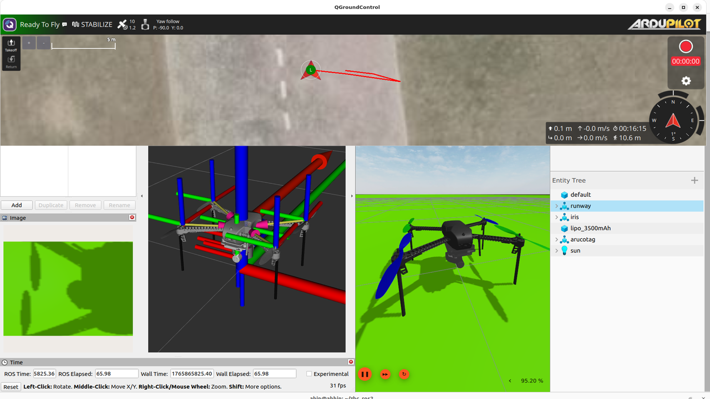
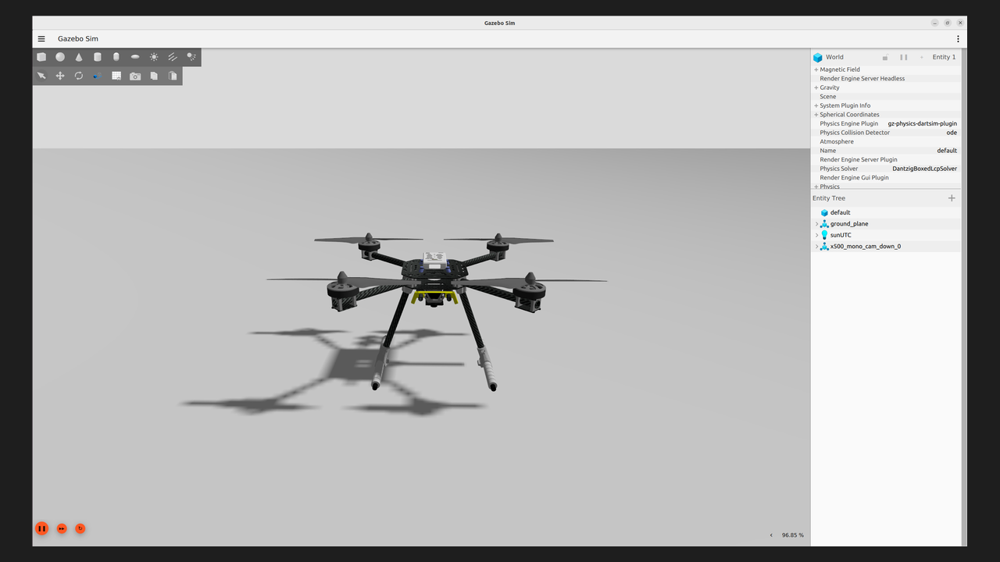
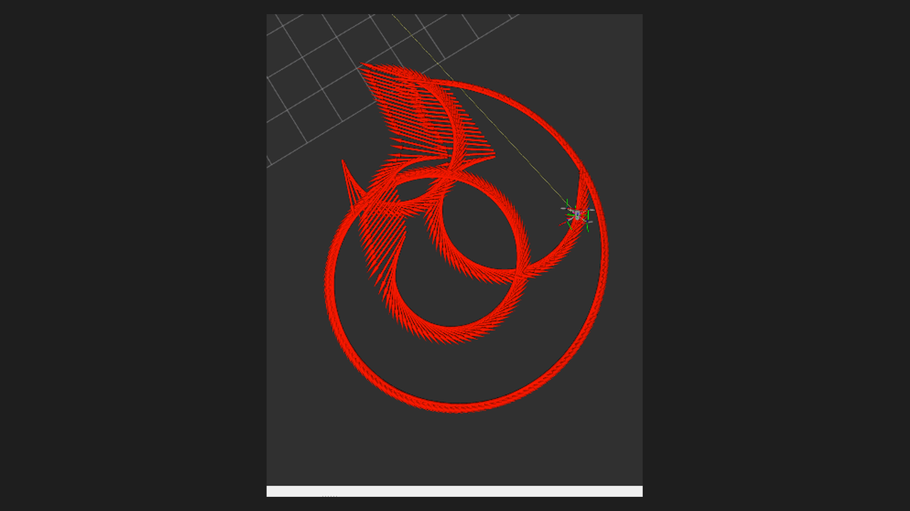
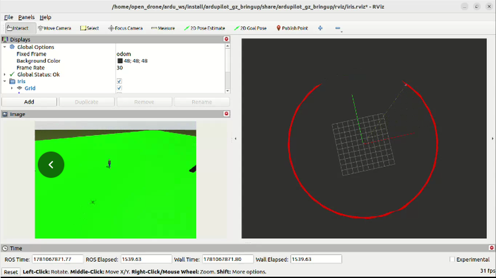
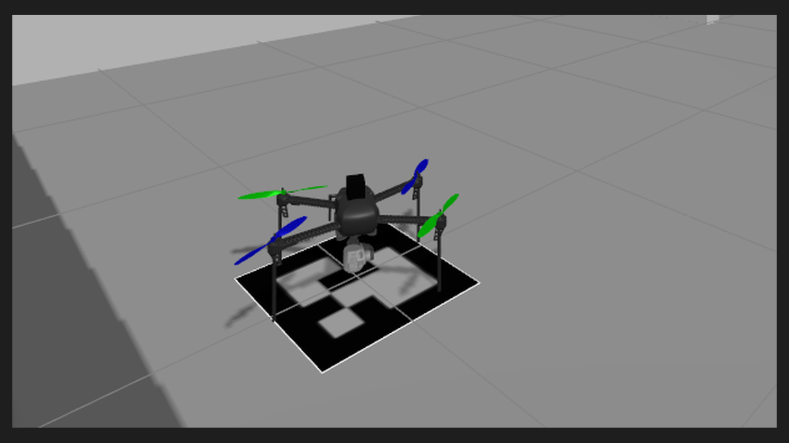

# Simulation

Test the whole mission in software before any hardware flight. The flight stack was validated both in simulation and on hardware.



*Full software-in-the-loop (SITL) simulation environment with ArduPilot, Gazebo synthetic camera feed, RViz AprilTag detection, and QGroundControl.*

## What you need

- Ubuntu 22.04 workstation (or the Docker environment) with ROS 2 Humble and MAVROS
- ArduPilot SITL (ArduCopter) and MAVProxy
- Gazebo Garden / Fortress with a camera sensor plugin on the drone and an AprilTag target ground plane

| Simulated Drone Model (Gazebo) | Ground AprilTag Landing Pad |
| :---: | :---: |
|  |  |
| *S500 Quadcopter model with downward-facing mono camera sensor* | *Simulation world ground plane with concentric AprilTag landing marker* |

## 1. Start SITL

```bash
cd ~/ardupilot/ArduCopter
sim_vehicle.py -v ArduCopter -f gazebo-iris --model JSON --map --console
```

For a quick test without Gazebo, use `sim_vehicle.py --console --map`. The landing phase needs a camera image with the tag, so full precision landing requires Gazebo.

## 2. Start MAVROS

```bash
ros2 launch mavros apm.launch fcu_url:=udp://:14550@127.0.0.1:14555
```

## 3. Start the camera and tag detection

Start the simulated camera bridge and `apriltag_ros` so that `/detections` publishes:

Check topic publication frequency with:
```bash
ros2 topic hz /detections
```

| Camera Target Detection View | Dynamic TF Coordinate Frames |
| :---: | :---: |
|  |  |
| *Real-time detection overlay on simulated video stream* | *Target translation vector relative to camera optical frame* |

## 4. Start the flight stack

```bash
ros2 launch autonomous_flight_stack uav_core.launch.py use_sim_time:=true
```

Set `use_sim_time:=true` only if Gazebo publishes `/clock` and your other nodes use it too. Mixed settings between nodes cause frozen timers.

## 5. Run the mission

From the MAVProxy prompt:

```text
mode guided
```

The stack arms, takes off, flies to `target_lat` and `target_lon`, searches for the tag and lands. In the simulation the home position is the SITL start position, so set the waypoint close to it (within your test area) in your simulation `params.yaml`.

## What to check

- [ ] Takeoff reaches `takeoff_alt`
- [ ] Log shows `[CRUISE]` distance falling to under 1.5 m
- [ ] Log shows tag acquired, then `[APPROACH]`, then `[FINAL_APPROACH]`
- [ ] Tag handoff messages appear as the drone descends
- [ ] LAND engages and the vehicle disarms
- [ ] Failsafe: stop MAVROS during the mission and confirm the RTL behaviour

## Differences from hardware

| Item | Simulation | Hardware |
| --- | --- | --- |
| `use_sim_time` | true when Gazebo provides `/clock` | false |
| Waypoint | Near the SITL home | Your test site |
| Camera | Gazebo camera | IMX500 |
| Wind and barometer noise | Simulated or absent | Real, affects the final landing |

---

<div align="center">

| [⬅️ Previous: **05 - Detection Range**](detection-range.md) | [📖 **Documentation Roadmap**](../README.md#documentation-roadmap) | [➡️ Next: **07 - Software Stack & Docker**](software/README.md) |
| :--- | :---: | ---: |

</div>
