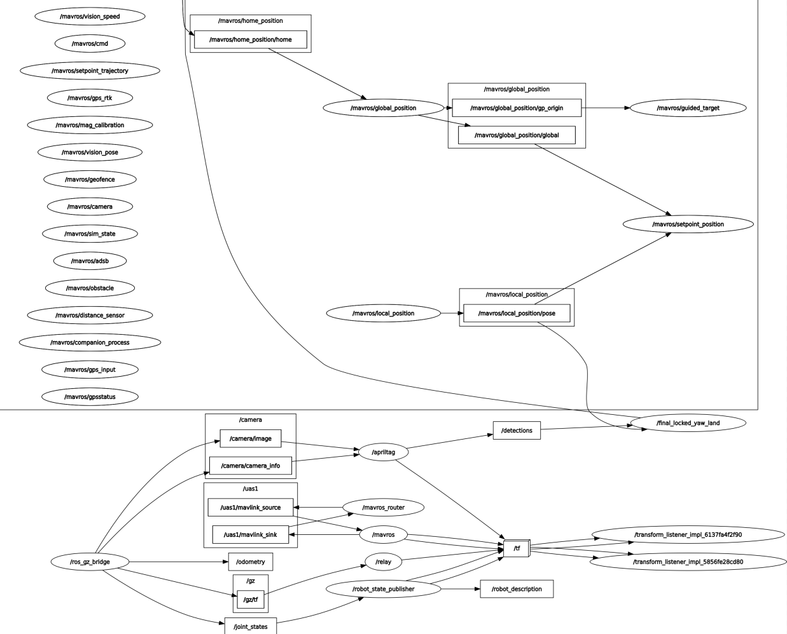

# Nodes and Interfaces

The flight stack is three ROS 2 nodes in the package `autonomous_flight_stack`, with two action definitions in `uav_interfaces`.

<p align="center">
  
  <br>
  <em>System computation architecture showing inter-node communications, action servers, and MAVROS bridge topics.</em>
</p>

```text
mission_executive --(NavigateToWaypoint action)--> navigation_server --> /mavros/setpoint_raw/global
        |
        +----------(PrecisionLand action)---------> landing_server ---> /mavros/setpoint_velocity/cmd_vel_unstamped
                                                         ^
                                      /detections (apriltag_ros), /mavros/state,
                                      /mavros/local_position/pose, /mavros/global_position/rel_alt
```

## mission_executive

Owns the mission: when to start, arm, takeoff, which tags, and what to do when something fails.

| Item | Details |
| --- | --- |
| Starts when | Flight mode is `GUIDED` (checked once per second) |
| Subscribes | `/mavros/state`, `/mavros/global_position/global` |
| Service clients | `/mavros/cmd/arming`, `/mavros/cmd/takeoff`, `/mavros/set_mode` |
| Action clients | `navigate_to_waypoint`, `precision_land` |

Sequence:

1. Mode becomes GUIDED, the node arms the vehicle.
2. If armed, it sends a takeoff command to `takeoff_alt`.
3. After a fixed 5 s wait it sends the waypoint goal to the navigation server.
4. On arrival it sends the tag list and priorities to the landing server.
5. The landing result is logged: success means touchdown confirmed.

Failsafe: if the MAVROS state heartbeat is older than 5 s, a goal is rejected, or navigation fails, the node sets mode **RTL**.

## navigation_server

Flies to a GPS position.

| Item | Details |
| --- | --- |
| Action | `navigate_to_waypoint` (`uav_interfaces/action/NavigateToWaypoint`) |
| Publishes | `/mavros/setpoint_raw/global` (`GlobalPositionTarget`) at 20 Hz |
| Subscribes | `/mavros/global_position/global` |
| Frame | `FRAME_GLOBAL_REL_ALT`, altitude relative to home |
| Done when | Distance to target is below 1.5 m |

Goal: `target_lat`, `target_lon`, `target_alt`. Feedback: `distance_remaining`. Result: `success`, `message`, `final_distance`. ArduPilot GUIDED needs continuous setpoints, which is why it publishes at 20 Hz. The distance uses an equirectangular approximation, which is accurate for short distances. The node also computes a bearing to the target for the yaw field, see [../known-issues.md](../known-issues.md) for how the type mask treats yaw.

## landing_server

Precision landing on the nested tag. The algorithm is described in [../landing-algorithm.md](../landing-algorithm.md).

| Item | Details |
| --- | --- |
| Action | `precision_land` (`uav_interfaces/action/PrecisionLand`) |
| Subscribes | `/detections` (`apriltag_msgs/AprilTagDetectionArray`), `/mavros/state`, `/mavros/local_position/pose`, `/mavros/global_position/rel_alt` |
| Publishes | `/mavros/setpoint_velocity/cmd_vel_unstamped` (`Twist`) at 20 Hz |
| Service client | `/mavros/set_mode` (LAND, RTL) |

Goal: `target_tag_ids` and `tag_priorities`. Only tags in this list are used. Feedback: `current_phase`, `current_alt`, `tag_visible`, `active_tag_id`, `err_x`, `err_y`. Result: `success`, `message`.

A watchdog zeroes the velocity command if the control loop stalls for more than 0.6 s while in GUIDED.

## Actions

```text
# NavigateToWaypoint.action
float64 target_lat
float64 target_lon
float64 target_alt
---
bool success
string message
float64 final_distance
---
float64 distance_remaining
float64 current_speed        # declared, not currently filled in
```

```text
# PrecisionLand.action
int32[] target_tag_ids
float64[] tag_priorities
---
bool success
string message
---
string current_phase
float64 current_alt
bool tag_visible
int32 active_tag_id
float64 err_x
float64 err_y
```

## Topics the stack needs

| Topic | Type | Provided by |
| --- | --- | --- |
| `/detections` | `apriltag_msgs/AprilTagDetectionArray` | `apriltag_ros` |
| `/mavros/state` | `mavros_msgs/State` | MAVROS |
| `/mavros/global_position/global` | `sensor_msgs/NavSatFix` | MAVROS |
| `/mavros/global_position/rel_alt` | `std_msgs/Float64` | MAVROS |
| `/mavros/local_position/pose` | `geometry_msgs/PoseStamped` | MAVROS |
