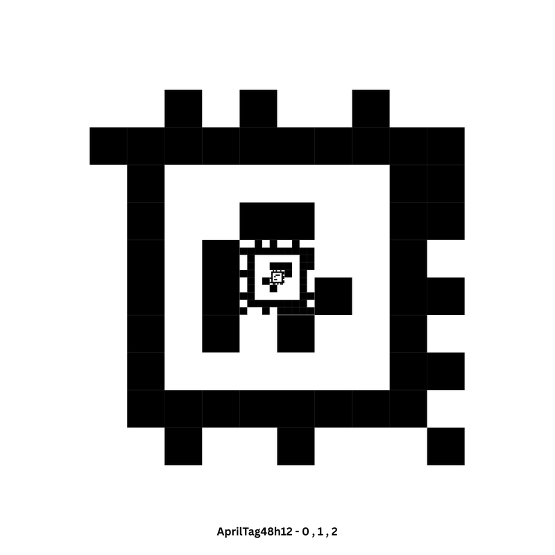

# Precision Landing Targets: Concentric Nested AprilTags

This document explains the optical design, mathematical principles, and practical fabrication of the landing target used by the autonomous flight stack.

---

## Target Marker Comparison: Digital vs Physical

To ensure high-precision tracking across diverse outdoor lighting and flight elevations, the target is constructed as a 3-tier concentric nested marker printed on matte paper and adhered to a rigid backing board.

| Digital Marker Template (Family 48h12) | Physical Printed Target (Mounted on Cardboard) |
| :---: | :---: |
|  |  |
| *Concentric 3-level vector layout: Tag 0 (outer), Tag 1 (middle), Tag 2 (inner)* | *Physical field target printed at 1:1 scale on non-glare matte stock and mounted on rigid cardboard* |

> [!NOTE]
> *Photo Upload Placeholder*: If `apriltag_nested_printed_cardboard.jpg` is not yet in your local directory, take a top-down photo of your physical printed cardboard landing pad and save it as:  
> `docs/images/tags/apriltag_nested_printed_cardboard.jpg`.

---

## Single Tag vs. Nested Tag: The Altitude-Scale Dilemma

A common question in vision-based precision landing is: **"Why not simply use a single standard AprilTag or ArUco marker?"**

In monocular vision-guided robotics, a single fiducial marker suffers from an unavoidable fundamental limitation known as the **Altitude-Scale Dilemma (Scale Paradox)**:

```text
       HIGH ALTITUDE (10m)                       LOW ALTITUDE (0.5m)
    =========================                 =========================
     Single Small Tag (4.5cm)                   Single Large Tag (25cm)
         [   .   ]                               [     /-----\     ]
   Camera sees only ~5-8 px                   Tag exceeds camera FOV!
   -> DETECTOR FAILS (No Lock)                Border clipped -> TRACKING LOST
```

### 1. High-Altitude Constraint: Resolution Minimum
The apparent width of a tag in the image sensor (in pixels) is governed by the pinhole camera projection equation:
$$w_{px} = \frac{f \cdot W_{tag}}{Z}$$
where:
- $f$ is the focal length in pixels ($\approx 540\text{ px}$ for a $65^\circ\text{ HFOV}$ lens at $640\times480$).
- $W_{tag}$ is the physical width of the tag in meters.
- $Z$ is the drone's altitude above the ground in meters.

To successfully decode an AprilTag (family 48h12, which has a $12\times12$ data grid plus border), each bit requires at least 1.5 to 2 image pixels. Consequently, the minimum detectable tag size is typically **$15 - 20\text{ pixels}$**.  
If a single small tag ($W_{tag} = 4.5\text{ cm}$) is used, at an approach altitude of $Z = 8\text{ m}$:
$$w_{px} = \frac{540 \cdot 0.045}{8} \approx 3.0\text{ pixels}$$
At 3 pixels, the tag is completely indistinguishable from background noise, making visual acquisition impossible from cruise altitude.

### 2. Low-Altitude Constraint: Field-of-View (FOV) Clipping
Conversely, if an oversized single tag ($W_{tag} = 25\text{ cm}$) is used so it can be seen from $10\text{ m}$, the camera's ground footprint narrows as the drone descends:
$$\text{Ground Footprint Width} = 2 \cdot Z \cdot \tan\left(\frac{\text{HFOV}}{2}\right)$$
At a low altitude of $Z = 0.3\text{ m}$ (touchdown phase):
$$\text{Ground Footprint} \approx 2 \cdot 0.3 \cdot \tan(32.5^\circ) \approx 0.38\text{ m} = 38\text{ cm}$$
If the drone has any horizontal displacement ($>6\text{ cm}$), or roll/pitch tilt, the black outer perimeter of the tag is clipped by the camera frame edges. Because the AprilTag line-extraction algorithm strictly requires detecting the closed bounding quadrangle to compute pose, **clipping causes instantaneous tracking dropout right before touchdown**.

---

## Comparison Matrix

| Feature | Single Standalone Tag | Concentric Nested AprilTag (This Project) |
| :--- | :--- | :--- |
| **Operational Altitude Envelope** | Narrow (typically $1.5\text{ m} - 5.0\text{ m}$) | **Continuous wide dynamic range ($0.15\text{ m} - 12.0\text{ m}$)** |
| **High-Altitude Acquisition ($>8\text{ m}$)** | Requires giant tag ($>30\text{ cm}$) | **Outer Tag (22.7 cm) seamlessly acquired** |
| **Touchdown Resolution ($<0.4\text{ m}$)** | Giant tag gets clipped; small tag lost | **Inner Tag (1.6 cm) remains fully in frame** |
| **Touchdown Positioning Accuracy** | $\pm 10\text{ to }25\text{ cm}$ (due to late-stage blind spot) | **$\pm 2\text{ to }5\text{ cm}$ (sub-decimeter accuracy)** |
| **Failsafe Risk on Low Approach** | High (frequent tag loss triggers premature abort) | **Near zero (concentric optical handover)** |
| **Ground Pad Footprint** | Large or impractical | **Compact footprint (fits entirely on a standard 30 cm pad)** |

---

## Concentric Tag Hierarchy & Sizing

Our custom target nests three AprilTags from the high-density **48h12** family directly inside each other, sharing a common geometric center:

| Tag Level | Tag ID | Family | Physical Dimension | Operational Altitude Band | Role in Descent Pipeline |
| :--- | :---: | :---: | :---: | :---: | :--- |
| **Outer Tag** | `ID 0` | 48h12 | **22.7 cm** $\times$ 22.7 cm | $3.0\text{ m} - 12.0\text{ m}$ | Long-range waypoint arrival & search descent |
| **Middle Tag** | `ID 1` | 48h12 | **4.5 cm** $\times$ 4.5 cm | $0.8\text{ m} - 3.5\text{ m}$ | Mid-altitude centering & high-speed velocity damping |
| **Inner Tag** | `ID 2` | 48h12 | **1.6 cm** $\times$ 1.6 cm | $0.15\text{ m} - 1.0\text{ m}$ | Final precision touchdown & zero-error land trigger |

---

## Priority & Optical Handover Logic

The ROS 2 `landing_server` dynamically tracks the most relevant visible tag using priority weights defined in [`params.yaml`](../src/autonomous_flight_stack/config/params.yaml):

```yaml
tag_ids:        [0,   1,   2  ]
tag_priorities: [1.0, 0.8, 0.6]
```

### Handover Sequence:
1. **High Altitude ($6\text{ m} - 12\text{ m}$)**: Only **Tag 0** is resolved. Drone centers on Tag 0 center coordinates.
2. **Intermediate Descent ($2\text{ m} - 3\text{ m}$)**: Both **Tag 0** and **Tag 1** are detected. Since all three tags are geometrically concentric, their optical centers coincide.
3. **Low Altitude ($<1.5\text{ m}$)**: Tag 0 boundaries leave the camera field of view. The algorithm smoothly shifts priority to **Tag 1**.
4. **Terminal Touchdown ($<0.5\text{ m}$)**: Tag 1 exits the frame. The camera focuses on **Tag 2**, guiding the quadcopter within millimeters of target center until the flight controller triggers automatic disarm.

---

## Fabrication & Field Deployment Guidelines

1. **Printing Quality**:
   - Print at **1:1 scale (100%)** without page scaling or fit-to-margin options enabled.
   - Use high-resolution laser printing on **matte, non-reflective heavy paper** (glare from direct sunlight creates pixel bloom that degrades corner detection).
2. **Mounting on Cardboard**:
   - Mount the printed sheet smoothly onto a rigid, flat surface (corrugated cardboard or 3 mm foam board).
   - Ensure zero warping or air bubbles under the print.
3. **Quiet Zone Margin**:
   - Maintain a minimum **2.5 cm white border** (quiet zone) around the outer perimeter of Tag 0. AprilTag edge detectors require high contrast between the outer black ring and surrounding ground.
4. **Physical Measurement**:
   - Always verify the printed dimensions with a physical precision ruler:
     - Outer Tag black border: Exactly **$227\text{ mm}$**.
     - Middle Tag black border: Exactly **$45\text{ mm}$**.
     - Inner Tag black border: Exactly **$16\text{ mm}$**.

---

## Visual Assets Wanted for This Page

To make this documentation 100% complete, you can drop the following images into `docs/images/tags/`:
1. `apriltag_nested_printed_cardboard.jpg`: Photo of your actual printed target mounted on cardboard.
2. *(Optional)* `single_vs_nested_comparison.png`: An infographic or side-by-side photograph showing a single tag vs your concentric nested target.

---

<div align="center">

| [⬅️ Previous: **03 - Camera Holder Mount**](hardware/camera-holder/README.md) | [📖 **Documentation Roadmap**](../README.md#documentation-roadmap) | [➡️ Next: **05 - Optical Detection Range**](detection-range.md) |
| :--- | :---: | ---: |

</div>
